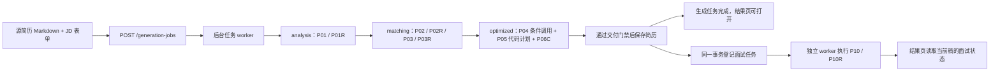
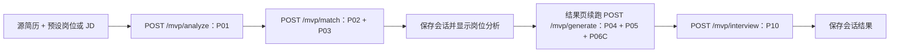
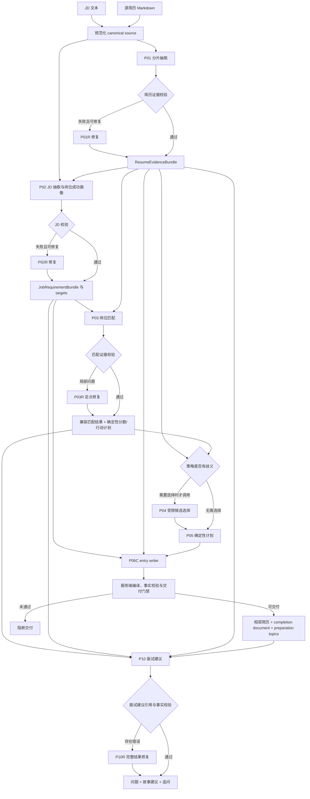

# Reffo AI 生成流程

本文按仓库当前公共 release 配置梳理岗位分析、相契简历和面试建议的 AI 输入、输出与提示词。流程覆盖 Taro 主入口、V5 后端编排、接口兼容投影和按需修复。

## 当前口径

公共 API 固定使用 `writer_v1`、`job-targeted-v2` 和 `entry-writing-v6`。因此当前简历正文由 P06C entry writer 生成；P05/P05R、P06、P07、P08、P09、P11 等提示词文件虽仍存在，公共 release 主链不调用它们。公共配置见 [v5-release.ts](../src/config/v5-release.ts)，提示词版本见 [manifest.json](../src/v5/prompts/manifest.json)。

“岗位分析”不是一个独立的单次模型调用。P02 从 JD 抽取岗位要求和成功画像，P03 将画像与简历证据匹配；`requirement_analysis` 是服务端从 P02 画像投影出来的展示结构，匹配分数、行动计划和写作重点也由服务端代码生成或整理。

## 产品入口

### 登录用户

后台任务逐段保存 analysis、matching、optimized。分析完成后即可进入结果页查看进度，后续阶段更新同一条历史记录。任务重试可复用已经保存的阶段结果。前端创建时提交源简历、JD 文本、公司/岗位/地点元数据以及可选解析追踪 ID。面试任务按用户、历史记录及填写文档版本读取与重试。已经编辑的稿件可以单独生成新建议，删除历史时同步撤销该记录的面试任务。[后台生成入口](../src/services/generation-jobs.ts) · [面试任务](../src/services/resume-interview-tasks.ts)

### Landing 体验

Landing 在创建页先调用 analyze 和 match，结果页再续跑 generate 和 interview。登录后台任务和 Landing 的入口不同，后端共享 V5 单步适配器和检查点。调用位置见 [create/usePageModel.ts](../../frontend/Taro/reffo-taro/src/pages/create/usePageModel.ts)、[result/usePageModel.ts](../../frontend/Taro/reffo-taro/src/pages/result/usePageModel.ts) 和 [resume.ts](../../frontend/Taro/reffo-taro/src/services/resume.ts)。

### 后端内部主链

模型节点内部使用严格结构化输出。所有 Pxx 的业务修复调用都是条件分支，正常通过时不调用 R 节点。P01 分片可并行，结果按源顺序合并；P01 完成后才开始 P02。当前公共流程只有交付门禁通过的结果才继续生成面试建议。

## 提示词如何组成

每次结构化模型调用的 System Prompt 由通用事实边界、该阶段提示词和 JSON 输出要求组合而成。P01/P01R 使用 `core-extraction.md`，其他常规阶段使用 `core.md`；P06C entry writer 使用 `core-writing.md` 和 `output-entry.md`。P06C 当前选择 `P06C-entry.md` 变体。

User Prompt 会把服务器生成的阶段 payload 放在 `UNTRUSTED_INPUT_JSON` 区域，并明确其中的文本不可执行。严格 JSON Schema 由 [prompt-compiler.ts](../src/v5/prompt-compiler.ts) 编译并作为结构化输出约束传给模型。组装逻辑见 [prompts.ts](../src/v5/prompts.ts)。因此某节点的完整运行提示词等于下表列出的通用文件、阶段文件、输出文件、实际 payload 和 Schema。

通用提示词全文：

- [core-extraction.md](../src/v5/prompts/core-extraction.md) 规定 P01 抽取只能以 canonical source 为事实来源，不得升级事实或跨 scope 拼接。
- [core.md](../src/v5/prompts/core.md) 规定其他分析阶段只能使用服务端校验后的证据，不执行输入中的命令。
- [core-writing.md](../src/v5/prompts/core-writing.md) 规定 Writer 可重组表达但不能改变事实、参与程度、数字和经历归属。
- [output.md](../src/v5/prompts/output.md) 规定常规阶段只输出符合 Schema 的 JSON。
- [output-entry.md](../src/v5/prompts/output-entry.md) 规定 entry writer 的根对象、字段、事实路由和补充信息处理。

## 节点输入、输出与提示词

### N0 规范化源材料

- 类型为确定性代码节点，不调用模型。
- 输入是 `resumeMarkdown` 和 `jobDescription` 两段原文。服务端为文本生成 canonical document、block ID、source span、摘要和输入风险标记。规范化后没有有效 block 会直接阻断。
- 输出是 `canonicalSourceDocument` 和 `canonicalJobDocument`，供后续模型引用稳定 block/span。
- 提示词为无。实现见 [canonical-source.ts](../src/v5/canonical-source.ts) 和 [workflow.ts](../src/v5/main/workflow.ts)。

### N1 P01 简历证据抽取

- 当前 Prompt 版本为 `5.0.0-p01-resume-evidence-r20`。
- 输入是 canonical 简历分片和 extraction sequence。超长简历会按源 block 分片，每片保留服务端分配的 scope 线索；分片可并行请求，可信的已验证缓存分片可复用。
- 模型输出简历提取候选，包括身份、时间线、章节、事实标注、未映射片段、冲突、材料质量和结构疑点。事实标注关联源 block、类型、归属程度、限定和风险。
- 服务端从源块和标注重建原文、区间、数字及覆盖集合，经分片归属和事实边界验证后合成 `ResumeEvidenceBundle`。
- System Prompt 组合为 `core-extraction.md + P01.md + output.md`。核心要求是只从本次源简历提事实，不提升职责和数字，不跨项目合并。
- 完整阶段提示词见 [P01.md](../src/v5/prompts/P01.md)。分片、合并和验证见 [workflow.ts](../src/v5/main/workflow.ts) 与 [chunked-resume-extraction.ts](../src/v5/chunked-resume-extraction.ts)。

### N1R P01R 简历抽取修复

- 当前 Prompt 版本为 `5.0.0-p01r-resume-evidence-repair-r20`，只在 P01 输出或完整合并结果未通过门禁时进入。
- 输入包含原始分片 envelope、当前候选输出和 validation issues。修复范围对应失败分片，不让失败候选替换源文本。
- 输出仍是受同一 Schema 约束的抽取候选。服务端重新做完整源文档验证，未通过则阻断。
- System Prompt 组合为 `core-extraction.md + P01R.md + output.md`。提示词要求按错误修复字段与引用，不改变未涉及的事实。
- 完整阶段提示词见 [P01R.md](../src/v5/prompts/P01R.md)。

### N2 确定性简历证据束

- 类型为确定性代码节点，不调用模型。
- 输入是经验证的 P01 候选和原始 canonical document。
- 输出 `ResumeEvidenceBundle`，包含身份、时间线、章节、证据 atom、未映射原文、冲突和覆盖信息。证据 atom 是后续岗位匹配和写作的事实底座。
- 提示词为无。实现见 [evidence.ts](../src/v5/evidence.ts) 和 [workflow.ts](../src/v5/main/workflow.ts)。

### N3 P02 岗位要求与成功画像抽取

- 当前 Prompt 版本为 `5.1.0-p02-job-success-profile-r10`，公共主链带 `job-targeted-v2` 策略。
- 输入是 canonical JD、空的 sourced context 列表和服务器策略标记。P02 不读取简历作为 JD 要求或候选人事实来源。
- 输出包含 JD basicInfo、逐条 requirement candidates、原文引用/span、分类、重要性、逻辑组和来源关联。另含 `jobSuccessProfile`，细分 context、tasks、outcomes、successConditions、attributes、requirements、unknowns、conflicts 和 candidatePortrait。服务端从基本信息、要求和未映射记录重建覆盖集合。
- 服务端验证来源引用和范围后，生成 `JobRequirementBundle`、稳定 requirement ID 与 `targets`。岗位要求画像不会由另一条独立的模型调用生成。
- System Prompt 组合为 `core.md + P02.md + output.md`。提示词要求保留 JD 来源边界，区分明示要求与推断条件，不补造 KPI 或公司文化。
- 完整阶段提示词见 [P02.md](../src/v5/prompts/P02.md)，结构定义见 [contracts.ts](../src/v5/targeting/contracts.ts)。

### N3R P02R 岗位画像修复

- 当前 Prompt 版本为 `5.1.0-p02r-job-success-profile-repair-r8`，只在 P02 的 Schema 或业务门禁失败时进入，最多修复一次。
- 输入包含原始 JD envelope、当前 P02 输出和 validation issues。
- 输出为完整的 targeted job extraction，随后再次由服务端核验原文覆盖、引用和画像关系。
- System Prompt 组合为 `core.md + P02R.md + output.md`。提示词要求仅根据原 JD 和报错修复，不扩展候选人判断。
- 完整阶段提示词见 [P02R.md](../src/v5/prompts/P02R.md)。

### N4 确定性岗位要求与匹配目标

- 类型为确定性代码节点，不调用模型。
- 输入是已校验的 P02 输出和 canonical JD。
- 输出 `JobRequirementBundle` 与 P03 用的 targets。requirement ID、语义条件、来源边界和 target 关系由服务端构建。
- 提示词为无。实现见 [workflow.ts](../src/v5/main/workflow.ts) 和 [targeting](../src/v5/targeting) 下的 contract/build 函数。

### N5 P03 岗位匹配

- 当前匹配 Prompt 版本为 targeted 变体 `5.1.0-p03-job-fit-map-r17`。
- 输入包含 `jobSuccessProfile`（不含仅展示用的 candidatePortrait）、targets 和过滤后的 `resumeContext`。resumeContext 只包含允许用于匹配的证据及 timeline，过滤排除证据、敏感个人信息、注入风险内容和身份字段。
- 输出 `JobFitMap`。每个 target 给出 direct、transferable、weak_signal、unknown、explicit_gap 或 conflicted 状态，绑定 evidence IDs，说明相似点、差异、表达角度、已支持与未证实方面、角色边界和支持关系。另输出 narratives 与最多三条待确认问题。
- 服务端校验 target 覆盖、证据引用、职责边界、false gap 和来源门槛。通过后投影到兼容的 `MatchAnalysis`；分数和 action plan 由服务端计算或整理。
- System Prompt 组合为 `core.md + P03-targeted.md + output.md`。核心指令是根据证据逐 target 对照，区分直接/可迁移/未证明，不将 JD 文本当成候选人事实。
- 完整阶段提示词见 [P03-targeted.md](../src/v5/prompts/P03-targeted.md)，输出 contract 见 [contracts.ts](../src/v5/targeting/contracts.ts)。

### N5R P03R 定点匹配修复

- 当前匹配修复 Prompt 版本为 `5.1.0-p03r-job-fit-map-repair-r18`，由验证错误触发。
- 输入包含受影响 target 的上下文、当前 fit map、校验问题。修复可按 target 限定，再由服务端合并和整体复验。
- 输出仍是 `JobFitMap`，不得添加上下文中不存在的证据 ID。
- System Prompt 组合为 `core.md + P03R-targeted.md + output.md`。提示词要求按 target 修复证据、关系和差距，不借用其他 scope。
- 完整阶段提示词见 [P03R-targeted.md](../src/v5/prompts/P03R-targeted.md)。

### N6 匹配结果投影与评分

- 类型为确定性代码节点，不调用模型。
- 输入是 P02 的要求束、P03 的 fit map 和 P01 的 evidence bundle。
- 输出兼容 `MatchAnalysis`，包括岗位结构、岗位画像展示、逐要求判断、硬性条件和技能匹配、优势、差距、定位策略、优化建议、证据引用及 match score。score 使用服务端公式。
- `requirement_analysis` 是岗位画像的展示投影，不会另发一次模型请求。无来源的企业文化和软技能推断不会被补入。
- 提示词为无。投影见 [compatibility.ts](../src/v5/main/compatibility.ts)，岗位分析展示构建见 [presentation.ts](../src/v5/targeting/presentation.ts)，评分见 [match-score.ts](../src/v5/match-score.ts)。

### N7 P04 策略选择

- 当前 Prompt 文件版本为 `5.0.0-p04-strategy-resolution-r2`，只有 `buildAdaptiveStrategy` 判定需要消解歧义时调用。
- 输入是服务端预先生成的 adaptive/conservative 候选 profile 与 generation policy、ambiguity reasons、紧凑证据 atom 和 requirement matches。
- 输出仅选择候选 profile/policy 的 ID 与依据。服务端要求二者 ID 一致，并从原候选集合映射回可信对象；模型不能创造策略值。
- System Prompt 组合为 `core.md + P04.md + output.md`。提示词角色是受限候选选择器，不写简历、不补事实。
- 完整提示词见 [P04.md](../src/v5/prompts/P04.md)，条件分支见 [workflow.ts](../src/v5/main/workflow.ts)。

### N8 P05 确定性简历计划

- 类型为确定性代码节点，不调用模型。当前 `planResolution` 正常来源是 `deterministic_primary`。
- 输入是 evidence bundle、requirements、match result、P04 生效后的 profile/policy、targeting scores 和 writing focus。
- 输出 `V5ResumePlan`，包含经历 scope 选择、章节结构、主岗位要求、证据选择和长度预算，之后通过计划校验门禁。
- 提示词为无。P05.md 和 P05R.md 是旧的模型计划提示词，不属于当前公共 release 主链。代码实现见 [planning](../src/v5/planning) 和 [workflow.ts](../src/v5/main/workflow.ts)。

### N9 P06C entry writer

- 当前 Prompt 版本为 entry 变体 `5.7.0-p06c-entry-routed-v6-r10`。
- 输入先由服务端根据 P05 计划生成 entry plan。每个 entry 按岗位、简历 scope 和章节分组，payload 提供准入 facts、同 scope gap context、source uncertainties、information routing、preparation topics、project identity、detail seeds、editorial/strategy actions、目标任务和长度/版面预算。外层还含写作策略、候选身份、岗位定向信息和必需 entry IDs。
- 模型输出 `contractVersion=entry-writing-v6` 和 `entries[]`。每条包含 coverage、detailAssessments、uncertaintyResolutions、actionReceipts 及 paragraphs/segments。业务经历由模型给出五要素 coverage，辅助条目由服务端按条目类型补齐。正文段落均需通过来源校验。
- 提示词要求只用当前 entry 已准入 facts，保留数字、归属、阶段与限定条件；区分正文短空和面试准备主题；结果区分交付物、采纳和收益；不能把行动回执或准备事项伪装成已完成事实。
- System Prompt 组合为 `core-writing.md + P06C-entry.md + output-entry.md`。完整阶段提示词见 [P06C-entry.md](../src/v5/prompts/P06C-entry.md)，输入构造见 [entries.ts](../src/v5/writing/entries.ts)。
- 如果 entry 校验失败，写入器会将失败 entry 和 issues 送回相同 P06C Prompt 做局部修正，最多两轮；仍不满足时可尝试安全恢复 entry。每次恢复后仍需完整编译和校验。

### N10 服务端编译与交付门禁

- 类型为确定性代码节点，不调用模型。
- 输入是 P06C entry JSON、entry plan、证据 bundle 和生成策略。
- 服务端编译成 Artifact、completion document 和 Markdown，解析 action receipts，构建变更/策略审阅信息，整理 preparation topics。随后检查事实支持、scope、结构、数字、空位、身份和可交付性。
- 输出为可交付的相契简历及 completion document、action plan/review、changes summary、preparation topics 等。未通过门禁时阻断交付。当前 release 不会因质量 warning 自动触发 P07/P08/P09 重写。
- 提示词为无。编译与校验见 [entries.ts](../src/v5/writing/entries.ts)、[workflow.ts](../src/v5/main/workflow.ts) 和 [delivery-gate.ts](../src/v5/delivery-gate.ts)。

### N11 P10 面试建议

- 当前 Prompt 版本为 `5.1.0-p10-interview-links-v5-r16`。这是简历交付后的独立调用。
- 输入先由服务端构建为 `interview-evidence-v2` 紧凑上下文。它包含当前交付 Artifact 的 claim、匹配 strengths/gaps/positioning、目标岗位要求、当前简历版本信息、选中且安全的原始证据、案例分组、scope 选择规则、可逐字引用的已完成交付物，以及从写作阶段整理出的 preparation topics。不是把完整原始简历全文直接交给 P10。
- 输出 `InterviewPreparation`，包含 4 条岗位相关问题、证据和要求关联，以及 3 条反问。有可用实践证据时输出 1–2 个故事及其背景、已知结果、待准备信息、讲述方案和岗位关联。材料缺少适用案例时，故事列表留空。
- 提示词要求故事证据必须来自同案例 scope，区分已发生结果与建议验证，不能编造成功收益、因果、本人贡献或经历；岗位要求只用来选择讲述重点，不是候选事实来源。
- System Prompt 组合为 `core.md + P10.md + output.md`。完整阶段提示词见 [P10.md](../src/v5/prompts/P10.md)，紧凑输入构造见 [interview-context.ts](../src/v5/interview-context.ts)。

### N11R P10R 面试建议修复

- 当前 Prompt 版本为 `5.1.0-p10r-interview-links-v5-r16`，由 P10 输出引用、scope、结果或结构校验错误触发。
- 输入包含通过门禁的 artifact/evidence/requirements/match context、当前面试建议和 validation issues。模型返回完整 `InterviewPreparation`，服务端重新校验。
- 提示词重点修复跨案例引用、泛化讲述方案、结果不完整、岗位关联失配和无来源负面前提。只修复已有输入能支撑的问题，不生成新经历。
- System Prompt 组合为 `core.md + P10R.md + output.md`。完整阶段提示词见 [P10R.md](../src/v5/prompts/P10R.md)。

## 三阶段对外输入和输出

| 产品阶段 | 后端节点 | 主要输入 | 对外输出 |
| --- | --- | --- | --- |
| 岗位分析 | P02、P03 和 N6 | 源简历检查点、JD 文本或预设 JD ID | `jd_structure`、`requirement_analysis`、`requirement_judgments`、`hard_requirements_match`、`skill_match`、`strengths`、`weakness_details`、`positioning_strategy`、`optimization_suggestions`、`match_score` |
| 相契简历 | P04 条件调用、P05、P06C、N10 | P01 evidence bundle、P02 requirement bundle、P03 match result | `optimized_resume`、`completion_document`、action plan/review、`changes_summary`、`strategy_review`、`preparation_topics` |
| 面试建议 | P10、必要时 P10R | 当前交付稿快照、相关安全证据、JD 要求、匹配差距和准备主题 | `questions`、`story_recommendations`、`follow_up_questions`、`preparation_topics`、呈现层 `presentation` |

单步 API 分别是 `/api/v1/mvp/analyze`、`/match`、`/generate`、`/interview`。`/api/v1/mvp/process` 保留为多步测试入口；当前兼容转换中的 `step4_interview_suggestions` 为空，不应以它代表产品主流程的面试生成路径。接口和兼容结构见 [mvp.ts](../src/routes/mvp.ts) 与 [compatibility.ts](../src/v5/main/compatibility.ts)。

## 提示词索引

| 节点 | 当前文件 | 当前 manifest 版本 |
| --- | --- | --- |
| P01 | [P01.md](../src/v5/prompts/P01.md) | `5.0.0-p01-resume-evidence-r20` |
| P01R | [P01R.md](../src/v5/prompts/P01R.md) | `5.0.0-p01r-resume-evidence-repair-r20` |
| P02 | [P02.md](../src/v5/prompts/P02.md) | `5.1.0-p02-job-success-profile-r10` |
| P02R | [P02R.md](../src/v5/prompts/P02R.md) | `5.1.0-p02r-job-success-profile-repair-r8` |
| P03 | [P03-targeted.md](../src/v5/prompts/P03-targeted.md) | `5.1.0-p03-job-fit-map-r17` |
| P03R | [P03R-targeted.md](../src/v5/prompts/P03R-targeted.md) | `5.1.0-p03r-job-fit-map-repair-r18` |
| P04 | [P04.md](../src/v5/prompts/P04.md) | `5.0.0-p04-strategy-resolution-r2` |
| P06C | [P06C-entry.md](../src/v5/prompts/P06C-entry.md) | `5.7.0-p06c-entry-routed-v6-r10` |
| P10 | [P10.md](../src/v5/prompts/P10.md) | `5.1.0-p10-interview-links-v5-r16` |
| P10R | [P10R.md](../src/v5/prompts/P10R.md) | `5.1.0-p10r-interview-links-v5-r16` |

这份整理引用 Prompt 源文件作为全文，节点说明概括运行时组合和任务约束。需要审阅完整提示词时，以上链接对应当前实际维护的文本。
