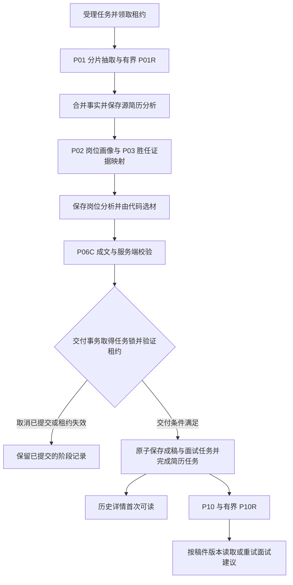

# Reffo V5 生成体验优化技术设计（合并后评审稿）

评审基线为 `private/resume-skeleton-hsl` 的 `99593f0`，对照合并前的 `e721212`。日期为 2026 年 11 月 26 日。本稿更新原方案的实施顺序、交付语义和验收方法。岗位成功画像、证据映射、定向成文和面试建议沿用原质量口径。[原提示词优化方案](v5-prompt-optimization-final-plan.md) · [真实数据评测手册](v5-live-evaluation-runbook.md)

## 1. 分批实施和评审决策

| 批次 | 交付项 | 通过条件 |
| --- | --- | --- |
| A · P01 配置验证 | P01/P01R 由代码固定关闭思考。对照合并后的历史构建，固定其余模型配置、分片规则及预算 | 原失败样本和较长的多分片样本均能通过整份 P01 校验并交付可读稿。核查所有首轮 P01 调用的思考模式、实际耗时、截断、修复和关键事实。冒烟结果用于决定下一步排查 |
| B · 任务交付与诊断 | 将阶段历史、任务状态和首版面试登记纳入一致的事务边界。完善 P01 和任务级失败归因 | SQLite 与 PostgreSQL 的并发和重试用例一致。固定 nonprod 的真实登录、结果页可读与面试独立重试均通过 |
| C · 按节点改进提示词 | 依据 A、B 的失败分布、离线回放和人工评审，逐个发布存在可复现问题的提示词改动 | 每次只改变一个节点及对应修复变体。新稿通过原质量门槛，成功率、延迟和实发调用数按同口径复测 |

2026 年 11 月 26 日确认按方案实施，由先提交的事务决定取消或交付。P01/P01R 在产品中固定关闭思考，移除运行时开关。C 的启动顺序依据复测结果。

## 2. 主链和首次可读时点

当前产品的登录用户路径使用 `writer_v1`、`job-targeted-v2` 和 `entry-writing-v6`。合并前后 V5 代码、Prompt manifest 和 Provider 代码逐文件一致。外部 API 沿用现有任务状态、进度和历史响应。用户在相契简历事务提交后就能打开成稿，面试建议随后按稿件版本生成。[发布配置](../src/config/v5-release.ts#L1) · [提示词版本](../src/v5/prompts/manifest.json) · [生成任务](../src/services/generation-jobs.ts#L143)

P02R/P03R 继续按结构和领域错误触发。P04 只在代码要求消解策略歧义时触发。P05 选材由代码执行。P12 继续用于离线评测。首稿预算按实际生产调用和确定性处理统计，区分 P01 分片、模型修复和业务阶段。[V5 编排](../src/v5/main/workflow.ts#L853)

## 3. P01 超时、恢复和诊断

原 nonprod 样本有 3 个分片。前两片在思考模式下约 72 秒截断，关闭思考后分别用约 7 秒和 9 秒通过。第三片以思考模式启动，任务在接近 120 秒的 P01 上限时报 `V5_PROVIDER_TEMPORARY_FAILURE`。现有记录无法区分最后一片的阶段超时和连接中断。首批验证固定关闭思考后，正常路径能否避免这两次慢速截断。[P01 时间预算](../src/v5/single-step-adapter.ts#L190) · [截断恢复](../src/v5/stage-runner.ts#L374)

1. **配置和对照。** 以旧构建作为思考模式对照，用候选构建验证固定关闭思考。保留当前 120 秒阶段上限、分片并发、P01R 额度、P02 启动条件和其他阶段思考策略。部署时通过 `/api/v1/mvp/health` 核对 `generation.extractionThinkingMode`、模型和 Writer 版本，并以实际 P01 调用事件复核。发布前处理在途任务。抽取指纹包含生效的思考模式，验证用独立冷缓存，重复请求记录实际缓存命中，失败的旧分片按现有指纹规则处理。[固定模式](../src/config/deepseek-thinking.ts#L6) · [阶段指纹](../src/v5/stage-fingerprints.ts#L9) · [健康回显](../src/v5/release.ts#L6)
2. **按真实错误分支处理。** 调用前记录单调时钟下的剩余阶段预算。预算耗尽、上游超时、主动取消、网络或流中断、限流、长度截断、结构错误和事实校验失败使用独立的原因值。预算触发源由持有该计时器的代码记录，SDK 的 `AbortError` 保留为观测值。P01R 仍只处理现有规则允许的修复候选。复测后若仍出现预算耗尽，再评估是否需给长文分配分片启动预算。若多片重复截断，则先看输出体积、可去重字段和分片密度。若为网络或限流，则检查容量及既有有界重试。
3. **已验证结果恢复。** 同一用户、同一源简历和同一提取指纹下，在现有缓存有效期内复用已通过校验的分片。按原始序号合并并重新跑整份校验，整份通过后才进入岗位阶段。当前在线部分分片检查点随进程存活，完整分析另有持久缓存。只有现场数据表明重启或跨实例导致重复消耗显著，才评估持久化部分分片，届时复用现有租约、归属及源材料删除约束。[缓存入口](../src/v5/single-step-adapter.ts#L64) · [分片校验与保存](../src/v5/main/workflow.ts#L2062) · [P01R 调度](../src/v5/main/workflow.ts#L2164)
4. **补齐日志。** 复用 Harness 的 `runId`、阶段、分片序号、现有调用计数和 `provider_calls` 分类。补充有效思考模式、剩余阶段预算、`finishReason` 和最终阶段原因。长度截断可由 Provider 正常返回，再由阶段校验判失败，需用两层事件关联。日志记录耗时、计数、状态和枚举错误码。若数据库观测写入本身成为尾延迟，再对记录过程加独立测时。上线前核实 nonprod `provider_calls` 诊断迁移及新字段实际可读。[调用记录](../src/services/provider-call-recorder.ts#L66) · [分片观测事件](../src/v5/main/workflow.ts#L2020) · [诊断迁移](../../supabase/migrations/202611200001_llm_diagnostics.sql)

## 4. 交付与取消的事务设计

在本地用合成样本将取消请求插入 `saving` 后、最终保存前。取消接口返回 200，任务终态为 `cancelled`，历史已经出现正文，面试任务缺失。原因是取消处理会用当前任务 `payload` 重建完整历史，可能把 Writer 输出提前写入历史。最终交付另外写历史和 `completed`，两个请求之间存在竞态。[取消路由](../src/routes/generation-jobs.ts#L163) · [交付顺序](../src/services/generation-jobs.ts#L184)

| 场景 | 预期状态 | 执行条件 |
| --- | --- | --- |
| 取消先提交 | `cancelled`。已有阶段历史保留，进行中进度收敛。未交付的正文和首版面试任务均未发布 | 取消事务锁定所属任务，清除租约。只修改既有阶段历史的进度字段 |
| 正式交付先提交 | `completed`。当前正文与同稿件版本的首个面试任务一起可见。随后取消按现有终态冲突约定返回 409 | 交付事务核对当前 `running/saving`、有效租约、所有者及历史版本，随后写成稿、初始面试任务及任务终态 |
| Worker 租约过期或被重领 | 旧 Worker 写入被拒绝。新 Worker 从已提交阶段继续 | 写入检查租约令牌、过期时间和预期阶段。状态或版本冲突时重新读取，已经提交的成功结果按原回执收敛 |
| 成功响应丢失或中途事务失败 | 同一请求重放原回执，或由有效租约下的 Worker 重试数据库提交 | 提交键包含任务、操作和内容摘要。最终交付摘要同时绑定稿件与首版面试任务版本。先在任务锁内查找同一操作的有效回执，再验证新写入的终态、版本和租约。遇到冲突时保留已保存的用户编辑 |
| 面试失败或稿件已编辑 | 已交付的简历继续可读。面试重试按当前稿件版本执行 | 复用稿件版本摘要和现有面试任务唯一键，拒绝旧稿结果覆盖当前页面 |

**后端落点。** `generation-jobs.ts` 在事务外运行模型、校验输出和准备可信基线。分析、岗位匹配的阶段保存与任务推进，以及最后交付和失败收敛，由生成任务仓储在同一事务里完成。取消路由同样走仓储，由数据库读取最新任务行决定结果。SSE 只在提交后发布，重连时用任务查询和历史详情恢复。客户端跳过补全校验的能力仍仅供服务端生成写入，正式交付应运行可信行动基线的处理和面试登记。已验证的模型输出先保留在 `saving` 检查点，可在版本兼容且租约有效时重放最终提交。[任务进度](../src/services/generation-jobs.ts#L143) · [可信快照](../src/services/resume-completion-snapshot.ts#L121) · [面试按版本投影](../src/services/resume-interview-tasks.ts#L14)

**数据库落点。** Supabase 新增仅供 `service_role` 调用的生成任务提交及取消 RPC，复用 `commit_resume_history` 的版本检查、回执和既有面试任务触发器。先锁生成任务行，再进入历史提交函数，核对所有者、关联历史 ID 和预期阶段。以取得锁后的数据库时间判定租约是否有效。持锁期间只执行数据库操作。历史版本冲突或面试任务登记失败时回滚整笔事务。SQLite 将现有历史写入和回执逻辑拆为可接收当前连接的内部写入步骤，由同一层 `BEGIN IMMEDIATE` 包住任务和历史写入。[历史提交 RPC](../../supabase/migrations/202611130008_completion_upgrade_cas.sql#L3) · [生成任务表和租约](../../supabase/migrations/202610130001_resume_generation_jobs.sql#L1) · [面试任务触发器](../../supabase/migrations/202611250001_resume_interview_tasks.sql#L38) · [SQLite 历史事务](../src/repositories/resume-history-repository.sqlite.ts#L204)

**既有历史。** 老版本已交付稿继续按现有历史契约读取。重领旧任务时，发现有正文但缺少面试登记的关联稿，需先核对当前稿件版本与可信面试基线，再按唯一键幂等补登记。异常状态带错误原因进入诊断。既有已取消任务保持已取消状态，批量补登记不随该版本部署执行。[版本指纹](../src/services/generation-job-version.ts#L30) · [面试任务版本](../src/services/resume-interview-tasks.ts#L14)

## 5. 提示词改动的触发条件

下表是待实证的改动范围。先用固定响应验证能否由编译、校验或投影解决，再比较候选提示词的真实输出。每次记录 Prompt manifest、组装后输入长度、调用次数及恢复分支。[原节点职责](v5-prompt-optimization-final-plan.md#5-各阶段提示词与代码职责) · [实际提示词版本](../src/v5/prompts/manifest.json)

| 节点 | 输入与交付 | 候选调整与验收 |
| --- | --- | --- |
| P01/P01R | 源简历分片、结构定位及失败片诊断 → 可追溯事实、身份、时间线和结构候选 | 先验证配置。仍有重复截断或同类漏抽取时，合并重复说明，突出每块一条标注、同 scope 来源、时间线与归因，以及原文数字保真。P01R 继续聚焦失败片。检查学历、同公司多段经历、有限归因、计划与已完成事实 |
| P02/P02R | 原始 JD 和来源块 → 岗位要求、任务、成功条件及证据预期 | 若重复出现 JD 漏块、引用不一致或显式要求误判，将对应结构规则前置，给出一组简短正例。检查明示、推断和未知的边界，以及人工标注的核心任务召回和查准率 |
| P03/P03R | 岗位画像与简历证据 → 直接、可迁移和待核验的胜任关系 | 若反复出现错归因或凭关键词建立强关系，简化关系判断顺序，突出来源和支持强度。P03R 优先复用已有的目标链接局部修复。核对证据 ID、覆盖和硬条件语义 |
| P04/P05/P05R | 策略信号和可用证据 → 策略决策、选材与写作计划 | 先测 P04 触发率及其是否实质改变策略。当前评审批次采用已有的 P04 条件触发与代码选材 |
| P06/P06C/P07/P08/P09 | 当前入口由 P06C 消费代码写作计划和证据 → 正文分段、来源及结构化补全信息 | 若实测出现职业经历覆盖失败、段落缺失或引用错位，针对高频错误缩短重复指令，保留选材目标、可证实措辞、证据引用和留白格式。继续使用现有局部恢复及服务端门禁。P06、P06D、P07、P08、P09 沿用现有路由 |
| P10/P10R | 当前稿已确认事实、岗位要求和匹配结果 → 问题、故事、讲述提纲与反问 | 若讲述提纲或引用再次失败，用一条同案例的有效 JSON 示例强化现有数组、同 scope 引用和无证据留空约定。核对问题的岗位相关性、故事可讲性、事实一致性和版本绑定 |

## 6. 测试、质量和发布验收

| 验证 | 样本与方法 | 验收条件 |
| --- | --- | --- |
| 本地确定性回归 | 同一生成 fixture 在保存前、历史写后及提交后注入取消、断连、重领和响应丢失。在隔离 SQLite 和 PostgreSQL 上断言最终状态 | 只有一次有效交付和一项对应版本的首版面试任务。已取消任务没有提前发布的正文。阶段历史可恢复，重复请求、失败重试和旧租约均符合事务约定 |
| nonprod 登录冒烟 | 用原报错样本和一份较长的多分片样本记录冷启动，补一次同输入重复提交。通过实际 H5 入口验证实时进度、首稿可读、首次保存与面试独立重试 | 健康检查、实际调用配置和迁移一致。两份首稿均可读且通过关键事实核对。面试失败或断线时能继续使用已交付简历，重连后能读到正确状态 |
| 体验对照 | P01 用旧构建的 `enabled` 和候选构建固定的 `disabled` 对照。交付设计验证用 `99593f0` 与候选提交，双方固定同一 P01 配置。提示词批次比较相邻冻结版本。A/B 用同一组输入、相同模型与预算，冷缓存和确认命中的重复提交分别报告 | 首稿和面试分别报可用率、P50/P95、物理调用和 Token，按统一截止时间比较。故障、超时及未执行样本分别报数。按原方案判断整体 P95 是否回归 |
| 人工质量 | 对照原简历与 JD，核查数字、限定语、本人贡献、项目归属和学历。用既有黄金集与同人多岗样本评审岗位针对性。面试增加当前稿版本、故事依据及实际可回答性检查 | 沿用原质量门槛，包括重大事实或隐私事故为 0、首次有效生成率至少 95%、有界恢复后至少 98%、人工可投递率至少 90%。小样本用于复现和冒烟，正式质量结论基于冻结验收集 |

取时从客户端提交开始。首稿以可正常渲染的历史详情首次读到已交付正文为准，并记录页面实际可读时点。面试以当前稿件首次返回有效面试结果为准。可用率以全部已受理的非故意取消任务为分母，失败、超时和上游失败导致面试不可用均保留。固定时限内可用率不足 95% 时，整体 P95 记为未达到。面试另报告已交付稿中的就绪率，便于识别独立面试问题。固定样本集如因预算或故障停止，未执行样本单列且无法完成整批验收。

现有 `compare-generation-jobs.ts` 适用于两个隔离的本地进程，遇到超时会停止后续样本。正式配对执行按独立样本或小批次调用，保留所有成功、失败和未执行记录。固定 nonprod 使用登录态的 H5 操作与后端事件复核。准备记录提交号、环境、模型、各阶段思考配置、Prompt 版本、数据迁移版本、样本摘要和缓存状态。[配对工具](../scripts/compare-generation-jobs.ts#L203) · [评测手册](v5-live-evaluation-runbook.md#L96) · [质量阈值](v5-prompt-optimization-final-plan.md#L361)

## 7. 上线和回退

- **批次 A。** 记录固定 nonprod 的部署提交和实际调用模式。若事实覆盖回归，回退构建并重新核对健康接口。发布和回退按抽取指纹处理未完成任务和缓存。
- **批次 B。** 先在目标 Supabase 项目核对迁移记录和面试任务触发器，应用前向迁移并验证 RPC 权限与错误码。完成在途任务后切换 Worker，使同一数据库在切换后只接收新协议写入。应用回退时保留可兼容的数据库对象，停止候选 Worker 后恢复基线。若回退会恢复已复现的保存取消竞态，则暂停相关生成入口直至修复或验证对应的回退版本。已交付记录和对应面试版本继续可读。
- **批次 C。** 单节点提示词连同其修复提示词、manifest 和相关契约作为一组发布与回退。切换前处理在途任务。按阶段指纹从首个不兼容的检查点重新计算，使用现有显式重试和额度记录。人工编辑稿继续使用已保存的版本。依据现有阶段指纹约定检查回退范围。[任务版本处理](../src/services/generation-job-version.ts#L30)

评审阶段已核对源码、现有测试及上一轮本地合成复现。实施后的 PostgreSQL 并发验证、固定 nonprod 实测和黄金集评审待后续执行。

## 8. 实施验证记录

六分片合成样本的真实 DeepSeek P01 抽取用时约 14 秒，六次首轮请求均关闭思考并正常结束，显式学校名称保留。两份合成样本均保存首稿，首次交付分别约 168 秒和 157 秒。P02 和 P06C 在部分样本出现推理截断及后续恢复。P10 初试出现额外字段、事实校验问题和预算超时。P10/P10R r17 明确 Schema 字段边界，并固定关闭思考。同一批已保存成稿的面试独立重试均通过，约 16 秒和 28 秒，分别返回 4 道问题及 2 个故事，正文一致。以上取自本地 SQLite 和真实模型调用，固定 nonprod、原报错样本及黄金集另行验收。
