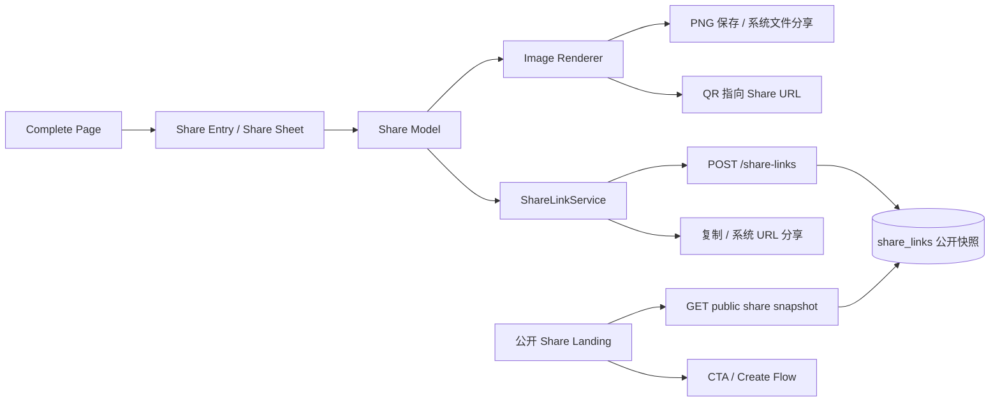

# Reffo 分享流程技术方案

> 状态：H5 首期开发中，主链路已落地，待视觉回归与真实环境联调<br>
> 目标平台：优先 H5/Web，接口和状态模型预留 RN/小程序扩展<br>
> 对应入口：卡片生成完成页右下角
> 设计范围：分享选择、分享图、分享链接、被分享者 Landing

## 1. 目标

卡片制作完成后，允许用户把一次求职成果传播给他人。分享内容有两种模式，分享方式有两种，因此完整能力是一个 `2 × 2` 组合：

| 内容模式 \ 分享方式 | 保存图片分享 | 分享链接 |
| --- | --- | --- |
| 携带岗位信息分享 | 生成绿色主题长图，展示工牌、岗位/姓名、匹配度、优化摘要和二维码 | 生成绿色主题公开 Landing，展示岗位版工牌，延时后出现说明和“即刻体验”按钮 |
| 空白分享 | 生成蓝色主题长图，展示“新的申请”空白工牌、通用文案和二维码 | 生成蓝色主题公开 Landing，展示空白工牌，延时后出现说明和“即刻体验”按钮 |

本方案解决以下问题：

1. 在卡片完成页稳定增加分享入口，不破坏当前“轻触屏幕回首页”和自动返回逻辑。
2. 统一组织岗位版/空白版的内容差异，避免图片、弹层、Landing 三处分别维护文案和视觉规则。
3. 生成可保存到本地、可继续转发的分享图。
4. 创建可公开访问但不泄露原始简历和 JD 的分享链接。
5. 被分享用户打开链接后先看到 Landing 预热态，经过等待时间后自动切换到体验引导态。
6. 为后续 RN、微信小程序分享和链接管理预留清晰边界。

## 2. 需求解释

### 2.1 分享入口

- 位置：卡片生成完成页右下角，不遮挡卡片主体和底部文案。
- 展示时机：历史记录或生成结果已经解析、卡片可渲染后。
- 隐藏时机：页面加载中、卡片数据缺失、正在跳转回首页。
- 点击行为：播放工卡绳下落、扣合和工卡上提的衔接动画，然后进入独立 `pages/share` 页面，不打开弹窗。
- 自动返回：点击分享后取消完成页的 10 秒自动返回，后续由分享页左上角返回。
- 底部过渡：完成页旧文案上移淡出，分享页新文案和分享方式按钮上移淡入。

### 2.2 两种内容模式

#### 携带岗位信息分享

只公开完成分享所需的信息，不复用完整历史记录数据：

- 可见：姓名、公司、岗位、地点、生成日期、匹配度、卡片颜色/图案、精简后的优化摘要。
- 不可见：原始简历、完整 JD、优化后简历、完整生成结果、邮箱/电话、内部 ID、用户 ID、认证信息。
- 颜色：沿用设计稿绿色主题。
- 当岗位字段缺失或全是占位值时，不允许创建岗位分享，展示明确提示。

#### 空白分享

- 不引用任何个人历史数据，不展示姓名、公司、岗位、评分或优化摘要。
- 卡片只展示“新的申请 / 从描述你的目标岗位 / 开始”。
- 颜色：沿用设计稿蓝色主题。
- 作为岗位信息不可用时的降级方案。

### 2.3 两种分享方式

#### 保存图片分享

- 用户选择内容模式后生成对应长图。
- 优先调用系统文件分享能力；不支持时下载 PNG 到本地。
- 图片包含二维码。二维码默认指向同一内容模式对应的公开分享 Landing，而不是泛用首页，以保证图片被二次转发后仍可进入一致体验并可统计来源。
- 图片在客户端本地生成，不上传原图；但需要先创建分享链接以获得二维码目标。

#### 分享链接

- 创建公开分享链接，优先使用系统分享 URL；不支持时复制到剪贴板。
- 复制失败时展示可手动选择和复制的 URL。
- 被分享者无需登录即可打开 Landing；“即刻体验”后进入创建流程。

### 2.4 分享页模式切换与工卡物理

- 岗位信息分享直接复用首页 `HomeScoreCard`，包括公司、姓名、岗位、地点、日期和岗位匹配度。
- 空白分享使用蓝色“新的申请”卡片。
- 两种模式不设置选择按钮，只通过绿色/蓝色背景、文案和卡片内容区分。
- 用户左右滑动切换模式；页面提供非交互的小圆点指示当前状态。
- 工卡绳和扣具需要表现物理感：用户可以拖转工卡，绳扣随位移改变角度，松手后以轻微过冲回到静止位置。
- 工卡拖动事件必须在工卡组件内部终止冒泡，避免拖卡时误触模式滑动。

### 2.5 Landing 两段式展示

1. `teaser`：加载成功后先展示工牌和居中的“一个岗位 / 一份专门准备的简历 / 尝试 Reffo，开启全新求职体验”。
2. `revealed`：等待建议 `2500ms` 后，通过 opacity/transform 自动切换为顶部工牌、说明文案和“即刻体验”按钮。

建议将等待时间配置为 `SHARE_LANDING_REVEAL_DELAY_MS = 2500`，而不是散落在组件中的 `setTimeout`。设计稿未给出精确秒数，开发前可由设计确认最终值。

计时规则：

- 首屏接口成功并完成首次渲染后开始计时。
- 页面在后台时暂停计时，恢复可见后继续，避免用户回来立即错过预热态。
- `prefers-reduced-motion: reduce` 时取消过渡动画，但保留状态切换和文案。
- 用户在预热态点击工牌或空白区域不提前切换，避免交互不确定。

## 3. 交互状态

### 3.1 完成页到独立分享页

```text
CompletePage
  ├─ loading
  ├─ ready
  │   └─ click share entry
  │       ├─ strap drops and clip captures card
  │       ├─ card lifts and complete copy fades upward
  │       └─ navigate to SharePage
  │           ├─ swipe content mode: job | blank
  │           ├─ drag and spring the badge
  │           ├─ save image
  │           ├─ share link
  │           └─ loading / success / error
  └─ returning-home
```

独立分享页规则：

- 岗位版作为默认模式；历史数据不完整时停留在空白版。
- 岗位版卡片必须直接渲染 `HomeScoreCard`，不能另做近似卡片。
- 下半区固定提供“保存图片分享 / 分享链接”两个主操作。
- 模式切换只更新页面状态和待创建数据，不在滑动时提前创建分享链接。
- 图片和链接操作成功后展示轻提示；失败留在分享页并提供重试。

### 3.2 图片分享状态

```text
prepare link -> render 1080 × 2400 PNG -> resolve share channel
                                      ├─ system file share
                                      └─ browser download fallback
```

- 同一 `historyId + mode` 的链接应幂等复用，避免多次生成图片时二维码和 URL 持续变化。
- 生成失败时不产出半成品图片，面板提示“分享图生成失败，请重试”。
- 文件名建议为 `Reffo-公司-岗位-YYYYMMDD.png`，并过滤文件系统非法字符；空白分享使用 `Reffo-新申请-YYYYMMDD.png`。

### 3.3 链接 Landing 状态

```text
loading
  ├─ invalid / expired / revoked -> error page
  └─ ready
      └─ teaser -> wait 2500ms -> revealed -> CTA enters create flow
```

错误态至少区分：

- 不存在或 token 无效：分享内容不存在。
- 已过期：分享已过期。
- 已撤销：分享已被作者取消。
- 网络失败：加载失败，提供重试。

错误态不显示任何历史数据，也不透露 token 对应的账号或记录信息。

## 4. 总体架构



核心原则：

- **单一分享模型**：弹层、图片、链接 Landing 都消费同一个 `ShareSnapshot`。
- **服务端快照**：创建分享时由服务端从历史记录生成白名单快照，前端不能自行提交公开内容。
- **私有数据隔离**：公开读取接口只能返回 `ShareLandingSnapshot`，不能返回 `ResumeHistoryRecord`。
- **平台适配**：分享能力封装为 service interface，H5 先实现，后续 RN/小程序只替换适配层。
- **稳定导出**：分享图使用独立渲染规格，不直接截屏 Taro DOM，保证长图比例、文字裁切和二维码位置稳定。

## 5. 前端模块设计

### 5.1 建议目录

```text
frontend/Taro/reffo-taro/src/
├── components/business/share/
│   └── share/
│       ├── ShareEntryButton.h5.tsx
│       └── ShareEntryButton.h5.scss
├── pages/share/
│   ├── PageView.h5.tsx
│   ├── PhysicsBadge.h5.tsx
│   ├── ShareBlankCard.h5.tsx
│   ├── usePageModel.ts
│   └── useShareAction.h5.ts
├── pages/share-landing/
│   ├── index.tsx
│   ├── index.config.ts
│   ├── PageView.h5.tsx
│   ├── usePageModel.ts
│   └── index.h5.scss
├── services/share.ts
├── types/share.ts
└── utils/share/
    ├── share-platform.ts
    ├── share-image-spec.ts
    ├── share-image-renderer.h5.ts
    ├── qr-code.h5.ts
    └── __tests__/
```

不建议把导出、API、计时器全部堆入 `pages/complete`：

- `pages/complete` 只控制入口、弹层生命周期和自动返回暂停。
- `pages/share` 管理模式滑动、物理工卡、分享动作、loading、错误和成功反馈。
- `services/share.ts` 负责链接创建、查询和撤销。
- `utils/share` 负责平台能力、图片规格和渲染。
- `pages/share-landing` 只消费公开快照和 Landing 状态机。

### 5.2 完成页集成

当前 `pages/complete/usePageModel.ts` 会在 10 秒后自动回首页，`PageView.h5.tsx` 的根节点也绑定整屏点击回首页。接入时需要：

1. 在 view model 暴露 `isSharingTransition` 和 `handleShare`。
2. 点击分享入口时调用 `event.stopPropagation()`，取消自动返回 timer。
3. 顺序播放绳扣下落、工卡上提、完成页文案退场，再导航到 `pages/share`。
4. 工卡拖动和分享页滑动使用独立事件边界，避免手势相互误触。
5. 发起跳转或导出时禁用重复点击。

### 5.3 分享模式模型

```ts
type ShareContentMode = 'job' | 'blank'
type ShareChannel = 'image' | 'link'

interface ShareSnapshot {
  schemaVersion: 1
  mode: ShareContentMode
  theme: 'green' | 'blue'
  card: JobShareCard | BlankShareCard
  landing: ShareLandingCopy
}
```

`ShareSnapshot` 由服务端返回。前端本地只持有面板选择、请求状态和当前公开快照。

### 5.4 图片导出

推荐使用固定规格 Canvas 2D 渲染，不引入 `html2canvas`：

- 规格：建议 `1080 × 2400` PNG，比例约 `9:20`，与设计稿长图接近；最终尺寸需视觉确认。
- 坐标和字号在 `share-image-spec.ts` 中集中维护，预览组件和导出器共用相同数据规格。
- Canvas 以目标分辨率一次绘制，不做浏览器 DOM 截图，避免 Taro px transform、字体加载和 CSS filter 导致跨浏览器差异。
- 所有长文本先规范化、截断并按固定行数排版，不允许导出时根据内容增加画布高度。
- 图片导出前等待字体就绪；字体失败时使用固定 fallback，并记录非敏感诊断信息。
- 二维码采用纯 JS QR encoder，生成矩阵后由 Canvas 绘制；不使用第三方二维码图片服务，避免分享 token 通过请求泄露。
- `canvas.toBlob()` 成功后走文件分享或下载；`toBlob` 不可用时降级为 PNG data URL。

H5 保存策略：

1. 支持 `navigator.canShare({files})` 时优先分享 PNG 文件。
2. 否则通过 Blob URL 和 `<a download>` 下载。
3. iOS Safari 等环境无法直接保存时，提示用户长按图片保存；必要时展示生成后的图片预览。

### 5.5 链接分享策略

- 创建成功后优先调用 `navigator.share({title, text, url})`。
- 不支持 Web Share 时使用 Clipboard API。
- Clipboard API 受权限限制时，展示只读 URL 供手动复制。
- 分享方法只传短 token URL，不把快照 JSON、历史 ID或简历内容放进查询参数。
- 创建请求使用 `Idempotency-Key`，图片和链接按钮重复点击不生成重复分享记录。

### 5.6 Landing 页面

新增公开页面 `pages/share-landing/index`，通过 `shareToken` 查询参数加载快照：

- 复用 `HomeScoreCard` 展示岗位版缩略卡；空白版使用独立简化组件。
- 首屏骨架与实际卡片保持相同宽高，避免接口完成后布局跳动。
- `teaser -> revealed` 使用 opacity/transform，切换期间固定整体高度。
- CTA 将 `source=share_link`、`shareId`、`mode` 作为归因参数进入 `pages/create`，不把公开快照复制进创建流程。
- 被分享者无需登录即可浏览 Landing；是否要求登录才生成简历沿用当前创建流程策略。

## 6. 后端与数据设计

### 6.1 为什么不能直接分享 history ID

当前 `resume_histories` 包含原始简历、JD、优化后简历和完整生成结果，并启用用户级 RLS。直接公开 history ID 会带来越权和隐私泄露风险，因此分享必须使用独立 token 和独立快照。

### 6.2 新增数据表

建议新增 `resume_share_links`，同时保留 SQLite 本地开发实现：

| 字段 | 类型 | 说明 |
| --- | --- | --- |
| `id` | uuid/text | 分享记录 ID |
| `user_id` | uuid/text | 创建者 |
| `source_history_id` | text/null | 来源历史记录；空白分享也可保留用于内部归因，但不公开 |
| `mode` | text | `job` 或 `blank` |
| `token_hash` | text unique | 可重算 HMAC token 的 SHA-256，不存明文 token |
| `snapshot` | jsonb/text | 经白名单生成的公开快照 |
| `schema_version` | integer | 快照结构版本 |
| `created_via` | text | `image` 或 `link`，用于分析首次创建意图 |
| `expires_at` | timestamptz | 过期时间 |
| `revoked_at` | timestamptz/null | 撤销时间 |
| `created_at` | timestamptz | 创建时间 |
| `updated_at` | timestamptz | 更新时间 |
| `last_viewed_at` | timestamptz/null | 可选统计 |
| `view_count` | bigint | 可选统计，默认 0 |

约束和索引：

- `token_hash` 唯一索引。
- `(user_id, created_at desc)` 索引。
- 业务层保证同一 `(user_id, source_history_id, mode)` 同时只有一个未过期、未撤销的分享；撤销后允许重新创建。
- `mode` 必须是 `job | blank`。
- `expires_at > created_at`。

安全策略：

- 表继续启用 RLS，所有者只能管理自己的分享记录。
- 公开读取只通过后端 service role/repository 完成，不向匿名客户端开放 Supabase 表查询。
- token 由随机分享 ID 和稳定服务端 HMAC 密钥派生，至少提供 128 bit 等效不可猜测性；服务端只保存 hash，同一条分享可稳定重建原 URL。
- `SHARE_LINK_TOKEN_SECRET` 在 nonprod/prod 必须是稳定随机密钥且至少 32 字符；更换密钥会主动使既有分享失效。
- API 和反向代理日志不记录完整 token、完整分享 URL或快照正文。
- 公开 GET 限制频率，并缓存为短 TTL；撤销需求较强时使用 `no-store` 或短 CDN TTL。

### 6.3 接口

#### 创建分享

```http
POST /api/v1/share-links
Authorization: Bearer <access-token>
Idempotency-Key: <uuid>
Content-Type: application/json
```

```json
{
  "history_id": "JD2026102500001",
  "mode": "job",
  "created_via": "image"
}
```

返回：

```json
{
  "success": true,
  "data": {
    "id": "uuid",
    "token": "public-share-token",
    "share_url": "https://reffo.example/share/<token>",
    "mode": "job",
    "schema_version": 1,
    "expires_at": "2026-11-24T10:00:00+08:00"
  }
}
```

实现规则：

- 只能对当前用户的 `history_id` 创建分享。
- 服务端读取 `resume_histories` 后构建 `ShareSnapshot`，忽略前端传入的任何展示字段。
- `mode=blank` 仍可记录 `source_history_id` 用于内部归因，但 `snapshot` 必须完全脱敏。
- 同一用户、同一 `history_id` 和同一 `mode` 已有有效分享时返回原分享，保证图片二维码和链接分享使用同一 URL。
- `Idempotency-Key` 相同且请求参数一致时也返回同一分享，用于防止网络重试写入重复记录。
- 默认有效期建议 30 天，可由环境变量配置。

#### 公开读取分享

```http
GET /api/v1/share-links/public/:token
```

返回：

```json
{
  "success": true,
  "data": {
    "share_id": "uuid",
    "schema_version": 1,
    "mode": "job",
    "theme": "green",
    "card": {
      "display_name": "Jeremy Smith",
      "company": "Echo",
      "position": "AI Product Manager",
      "location": "北京",
      "generated_date": "2025.12.15",
      "match_score": 88,
      "summary_lines": ["优化摘要第一段", "优化摘要第二段"]
    },
    "landing": {
      "brand": "Reffo",
      "teaser_title": "一个岗位",
      "teaser_subtitle": "一份专门准备的简历",
      "teaser_hint": "尝试 Reffo，开启全新求职体验"
    }
  }
}
```

明确禁止出现在公开接口中的字段：

- `resume_content`
- `jd_content`
- `optimized_content`
- `process_result`
- `result_context`
- `user_id`
- `source_history_id`
- 电话、邮箱、住址、社交账号等联系方式

#### 撤销分享

```http
DELETE /api/v1/share-links/:id
Authorization: Bearer <access-token>
```

首期可只提供接口和后端能力，管理入口放到后续“分享管理”需求。

### 6.4 ShareSnapshot 白名单

后端使用显式 mapper 构建快照：

```ts
function toPublicShareSnapshot(history: ResumeHistoryRecord, mode: ShareContentMode) {
  if (mode === 'blank') return buildBlankSnapshot()

  return {
    schemaVersion: 1,
    mode: 'job',
    theme: 'green',
    card: {
      displayName: sanitizeDisplayText(history.name, 24),
      company: sanitizeDisplayText(history.company, 32),
      position: sanitizeDisplayText(history.position, 40),
      location: sanitizeDisplayText(resolveLocation(history), 24),
      generatedDate: formatDate(history.created_at),
      matchScore: clampScore(history.match_score),
      summaryLines: buildPublicSummaryLines(history),
    },
    landing: LANDING_COPY,
  }
}
```

需要为 mapper 写测试，确保任意新增历史字段都不会自动扩散到公开快照。优化摘要应从当前卡片的 `strategy_body`/`buildResumeValueSummary` 结果中提取，并设置总字符和最大行数限制。

### 6.5 分享 URL 与链接预览

建议规范 URL 为：

```text
${PUBLIC_WEB_BASE_URL}/share/<token>
```

首期如果 Taro H5 仍使用 hash 路由，可先生成：

```text
${PUBLIC_WEB_BASE_URL}/#/pages/share-landing/index?shareToken=<token>
```

同时把真实 URL 构造规则收敛到服务端，前端只使用返回的 `share_url`。后续由网关/静态托管把 `/share/:token` 映射到 Landing 页面后，无需修改分享记录。

聊天软件链接预览依赖服务端可读取的 Open Graph metadata。首期可提供通用标题“一个岗位，一份专门准备的简历”；如需展示公司/岗位卡片预览，应由短链服务输出 OG metadata，不能把敏感快照放进 URL。

## 7. 隐私与合规

- 创建公开链接必须由用户主动点击分享动作触发，不随卡片生成自动公开。
- 独立分享页需要直接展示真实卡片预览，并提示“携带岗位信息分享会展示姓名、公司、岗位和优化摘要”。
- 空白分享必须做到数据层脱敏，而不只是 UI 隐藏。
- 分享快照和原历史记录解耦；用户修改或删除原记录后，已创建分享仍按快照策略工作，撤销链接后立即不可访问。
- 建议默认 30 天过期，并允许作者撤销。
- 图片属于用户主动导出的本地数据，不额外存储到服务端。
- 分析事件只记录 `share_id`、`mode`、`created_via` 等非敏感字段，不记录 token 和快照正文。
- 上线前同步检查隐私政策是否覆盖“用户主动公开分享内容”和分享链接有效期。

## 8. 平台兼容

### 8.1 H5 首期

- 完整支持独立分享页、PNG 导出、浏览器下载、Web Share、剪贴板和公开 Landing。
- Canvas、Clipboard、Web Share 均做 capability detection。
- 移动端和桌面端都要验证下载行为。

### 8.2 RN 后续

- 沿用 `ShareSnapshot` 和后端接口。
- 新增 `share-platform.rn.ts`，使用系统分享/文件保存适配器。
- 图片渲染可沿用 Canvas/View Shot/原生渲染方案，但不在 H5 文件中引用 RN-only 依赖。
- 二维码和长图排版必须共用数据规格，避免视觉分叉。

### 8.3 小程序后续

- 使用小程序分享卡片、保存到相册和二维码能力。
- 域名需要加入合法域名配置。
- 分享 token 长度、链接和场景值归因需要单独评估。

首期不在上述非 H5 平台做半成品兼容。

## 9. 异常与降级

| 场景 | 行为 |
| --- | --- |
| 完成页历史数据加载失败 | 不展示岗位分享，可展示空白分享或整页错误 |
| 公司/岗位/姓名为空 | 禁用岗位分享，提示改用空白分享 |
| 链接创建失败 | 图片可先导出不含动态二维码的纯分享图不作为首期默认；默认要求链接成功后再出图 |
| QR 生成失败 | 图片生成失败并可重试，不输出缺少二维码的设计稿 |
| 系统文件分享取消 | 视为取消，不报错，不改变分享记录 |
| 下载不支持 | 展示图片预览和长按保存提示 |
| Clipboard 权限失败 | 展示 URL 手动复制 |
| token 无效/过期/撤销 | Landing 显示对应错误态，不显示历史数据 |
| Landing 网络失败 | 骨架停留后显示重试 |
| 文本过长 | 固定行数截断，卡片和画布尺寸不变化 |
| 页面切到后台 | 暂停 Landing 延时和完成页自动返回，恢复后继续 |
| 用户连续点击分享 | 请求幂等，按钮短期禁用 |

## 10. 测试方案

### 10.1 前端单元测试

- `ShareSnapshot` 模式切换正确生成绿色/蓝色主题。
- 岗位数据不完整时岗位模式禁用。
- 长公司名、岗位名和摘要不溢出，截断规则稳定。
- 图片导出返回有效 Blob/PNG，尺寸为 `1080 × 2400`。
- QR 使用目标 share URL，且相同 `historyId + mode` 复用同一 URL。
- Web Share、下载、Clipboard 成功和降级路径。
- Landing 首先进入 teaser，fake timers 推进 `2500ms` 后进入 revealed。
- 页面隐藏/恢复后暂停和继续计时。
- `prefers-reduced-motion` 时不播放位移动画但完成状态切换。

### 10.2 后端测试

- 仅记录所有者可以创建分享。
- 不能用其他用户的历史记录创建分享。
- `mode=job` 公开快照只包含白名单字段。
- `mode=blank` 公开快照不含公司、岗位、姓名、评分和摘要。
- token 不落明文，重复 token 不可能碰撞。
- 相同 `Idempotency-Key` 返回相同分享。
- 无效、过期、撤销 token 返回明确错误。
- 创建接口带认证，公开 GET 不要求认证。
- 日志不输出 token、share URL 和快照正文。

### 10.3 页面与视觉回归

至少覆盖：

| 用例 | 验证点 |
| --- | --- |
| 完成页分享入口 | 移动端右下角不遮挡，点击播放绳扣/上提/文案退场并进入独立分享页 |
| 独立分享页 | 岗位版复用 `HomeScoreCard`，空白版蓝色卡片，左右滑动切换且无模式按钮 |
| 工卡物理 | 可拖转、绳扣联动、松手轻微回弹且不误触模式切换 |
| 岗位图片 | 绿色长图、岗位卡、摘要、QR、保存成功 |
| 空白图片 | 蓝色长图、空白卡、通用文案、QR、保存成功 |
| 岗位 Landing | teaser 到 revealed 切换，岗位卡与 CTA |
| 空白 Landing | teaser 到 revealed 切换，空白卡与 CTA |
| 异常 Landing | 无效、过期、撤销、网络失败 |
| 响应式 | `393 × 852`、窄屏、平板和桌面宽屏 |

建议验证视口为 `393 × 852`、`430 × 932`、`768 × 1024`、`1440 × 900`。视觉验收以设计稿的布局节奏、比例、主题色、文字层级和动效为准。

### 10.4 验收标准

1. 卡片制作完成后右下角出现分享入口。
2. 点击分享不会误触完成页回首页，转场完成后进入独立 `pages/share`。
3. 岗位分享页展示的是首页同款 `HomeScoreCard`；空白分享通过蓝色背景区分，左右滑动切换。
4. 工卡支持拖转和轻微物理回弹。
5. 四种 `内容模式 × 分享方式` 组合均可用。
6. 两张分享图与设计稿一致，文本不溢出，二维码可识别。
7. 图片可保存或通过系统分享发送。
8. 链接可复制或通过系统分享发送。
9. 被分享者未登录可打开 Landing。
10. Landing 先显示预热态，等待后自动显示说明和“即刻体验”。
11. “即刻体验”能进入正确的创建流程并携带来源归因。
12. 公开接口和图片/链接快照均不包含原始简历、完整 JD 或联系方式。
13. 无效、过期、撤销链接显示明确错误态。

## 11. 分阶段实施

### 阶段 0：设计和产品确认

- 确认长图固定尺寸和 `2500ms` 等待时间。
- 确认岗位分享是否展示姓名。
- 确认链接默认 30 天有效。
- 确认图片二维码指向对应分享 Landing。
- 确认首期仅上线 H5。

### 阶段 1：分享数据和接口

- 定义 `ShareSnapshot`、快照 mapper 和隐私白名单。
- 新增 `resume_share_links` 迁移。
- 实现 ShareLinkRepository 的 Supabase/SQLite 版本。
- 实现创建、公开读取、撤销接口及后端测试。
- 加入幂等、token hash、过期和撤销规则。

### 阶段 2：完成页和独立分享页

- 接入右下角分享入口。
- 暂停/恢复完成页自动返回。
- 实现完成页到分享页的绳扣、上提、文案换场动画。
- 实现岗位卡片复用、左右滑动物理工卡、分享方式入口、loading/error/success。
- 接入分享链接 API 和平台分享降级。

### 阶段 3：分享图

- 实现固定规格图片数据和 Canvas 渲染器。
- 接入 QR、PNG 导出、文件分享和下载降级。
- 完成岗位版、空白版视觉回归。

### 阶段 4：公开 Landing

- 新增 `pages/share-landing/index`。
- 实现公开快照加载、错误态、teaser/revealed 状态机。
- 接入 CTA 归因和创建流程。

### 阶段 5：联调与发布

- 执行 H5 构建、Jest、后端测试和四组合真机/浏览器验收。
- 检查隐私字段、日志、URL 和缓存策略。
- 验证分享链接在微信/浏览器内置浏览器中的打开、长按二维码和 CTA。
- 检查隐私政策和分享过期文案。

建议按“后端分享快照与 API -> 完成页/独立分享页 -> 图片/Landing”拆成多个 PR，避免一次提交同时改动数据库、导出和动效后难以定位回归。

## 12. 主要风险与待确认项

| 项目 | 建议默认 | 风险 |
| --- | --- | --- |
| 首期平台 | H5 | RN/小程序能力差异较大，半成品兼容会增加维护成本 |
| Landing 延时 | 2500ms | 设计稿未标明精确时长 |
| 长图尺寸 | 1080 × 2400 | 需设计确认最终比例 |
| 岗位分享展示姓名 | 展示 | 属于个人信息，面板必须预览并提示 |
| 分享有效期 | 30 天 | 需产品确认是否长期有效 |
| 图片二维码目标 | 同内容模式的分享 Landing | 若改为泛用首页，增长归因和体验一致性会下降 |
| 链接预览 | 首期通用 OG，后续短链服务 | SPA 通用 metadata 可能无法展示岗位定制卡片 |
| 优化摘要公开 | 截断后公开展示 | 必须用白名单和字符限制避免隐私扩散 |

在上述待确认项中，除“岗位分享是否展示姓名”属于明显隐私决策外，其余都可以先按建议默认值开发，并将参数集中配置。
