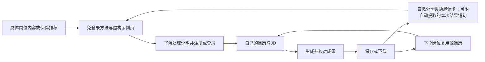

# Reffo 正式上线推广与增长方案

版本：V1.3，2026-10-19。产品基线：`feature/workflow-v5`，提交 `1e90476`。本文交付策略与执行设计，不代表新增功能已经实现或产品已完成上线验收。

配套文档：[分享与邀请产品需求](./02-分享与邀请产品需求.md) · [首月运营执行手册](./03-首月运营执行手册.md) · [生成结果分享卡方案](./04-生成结果分享卡方案.md)。

## 1. 先做出的经营判断

**Reffo 首发分享以邀请奖励为主：好友注册得额外 3 次岗位优化，完成首个真实任务后邀请人得 5 次；活动不设个人邀请数上限，以硬预算控制邀请增量权益。**

求职是阶段性、较私密的需求。奖励价值应直接、规则要在注册前说清；简历内容不应成为拿奖励的门槛。分享卡默认展示邀请权益，某次生成简历中的一条短原文只作为可关闭的补充内容。

建议批准以下五项方向：

1. **首发聚焦一个场景**：已有简历、有明确 JD、正在准备投递的求职者。先对照社招与有实习经历的应届生，再选效果更好的一组集中投入。
2. **首发以 H5 承接**：免安装先看虚构示例，自己的真实岗位任务登录后完成。RN、小程序不作为未经回归的推广承诺。
3. **P0 上线邀请奖励闭环**：好友验证注册即得额外 3 次；好友首次真实岗位简历任务交付后，邀请人得 5 次。奖励权益必须使用任务级账本，硬预算未批准或无法预留履约成本时不开活动。
4. **P0+ 增加生成内容补充展示**：从当前用户本次最终简历结果中自动取一条短原文，直接放在邀请卡权益信息下方；不让用户选段或改写，不调用模型另写分享内容。用户可预览后选择保留或关闭这段内容。
5. **首月只验证两个获客方向**：一个内容账号和一条经许可的社群/职业服务伙伴渠道；用激活、可用反馈和成本选优，不追求多平台铺量。

这里的“分享闭环”是用户自愿推荐、朋友理解用途、完成自己的任务、团队能辨认效果。不会要求用户先分享才能下载、看结果或继续使用。

## 2. 已知事实、假设与未确定事项

### 2.1 当前分支能支持什么

以下为静态源码核查，不等于生产环境或真机验收通过。根 README 与早期调研纪要有历史内容，能力判断以此分支的代码为准。

| 能力 | 分支事实 | 对运营的直接影响 |
| --- | --- | --- |
| 核心流程 | 源简历、JD、分析、匹配、简历生成、面试建议、保存历史已形成链路 | 可以围绕“同一段真实经历如何针对不同岗位表达”制作演示 |
| 首访体验 | Landing 有虚构人物与预设岗位体验，也可上传自己的简历 | 公开示例优先用静态内容；不为每个访客重复执行 AI |
| 用户体系 | 邮箱注册/验证码、登录及 OAuth 相关代码已存在 | 可建立账号级推荐绑定；具体生产登录方式仍需验收 |
| 分享 | 结果页 model 有 `Taro.showShareMenu` 占位，H5 页面未接入实际分享动作 | 尚无可运营分享入口、接收页、归因或奖励闭环 |
| 下载 | H5 结果页实际下载 Markdown | 不能宣传“现已支持 PDF/Word 一键导出”；正式推广前验证目标用户能否使用现有输出 |
| 配额 | 默认配置为每日 3 次，实际按分析成功且缓存未命中扣次 | 这不是“一天只生成 3 个岗位成果”，更不是邀请奖励钱包 |
| 评分 | 有源简历/岗位匹配信息，没有生成后重评的前后对照证据 | 不做“从 60 分升到 95 分”“ATS 通过率提升”素材 |
| 可观测性 | Harness 有模型调用、耗时、诊断和估算成本 | 可复用运行数据，但缺少产品渠道、分享、邀请漏斗 |
| 私有数据 | 简历历史和文件按用户隔离，包含完整经历及岗位信息 | 禁止直接拿私人结果 URL 或卡片截图作为公开分享对象 |

### 2.2 本方案的工作假设

- 上线时间未知，统一使用 **D0＝正式上线日**，不绑定秋招、春招或具体节日。
- 首批用户、人力与预算尚未确定。默认 **1 名运营主要负责人，每周 12–16 小时；工程和设计另有支持窗口**，这不是“一个人包办开发运营”。
- 邀请奖励沿用附件中的好友额外 3 次、邀请人 5 次；附件所列新用户基础 5 次作为权益配置建议，须与上线时全局新客权益及任务级额度核对后展示。
- 目标市场暂按中文 H5 用户；1–5 年经验社招为优先假设，应届生为对照组。这个细分范围需要访谈校准。
- 收费、付费转化、真实成本、渠道转化率和 LTV 未确定。所有预算、阈值、券规则都是待验证的方案参数。
- 代码默认次数不代表生产承诺。对外权益必须以实际发布配置和活动规则为准。

## 3. 产品定位与首批人群

### 3.1 对外主张

**一个岗位，一份专门准备的简历。**

解释句：把已有经历与目标 JD 对照，整理更相关的表达，生成可编辑的简历内容和面试准备建议；由你核对事实后使用。

传播证据采用三种形式：虚构案例的表达对照、真实产品操作演示、经用户单独授权的体验反馈。技术架构、Agent 数量、内部质量分作为解释材料，不做首页第一卖点。

| 场景 | 用户要完成的事 | 内容切口 | 产品承接 |
| --- | --- | --- | --- |
| 社招，有明确 JD | 从一份通用简历整理出这次投递版本 | “同一项目投运营与产品岗位，重点如何不同” | 自己的履历 + 自己的 JD → 核对并保存 |
| 应届，有实习或项目 | 把参与过程说明为有证据的行动与产出 | “没有结果数据时，哪些信息可以写、哪些不能编” | 虚构校园案例 → 导入自己的材料 |
| 职业服务伙伴 | 帮服务对象更高效地完成初稿与核对 | “工具负责初稿，顾问负责判断与事实核查” | 独立来源链接 + 用户自主提交，不代收整批简历 |

首周结合短访谈与陪伴任务，分别了解两组各约 5 人，记录：是否有真实 JD、最近一次投递如何改简历、输出格式要求、是否愿意上传、是否愿意推荐、推荐对象是谁。按“独立完成任务比例、可用反馈、再次使用需求、支持成本”选择主群体，不按谁更容易进群选择。

暂不优先：没有具体岗位且只想测分的人、从零代写且无法核对经历的人、要求保证 offer 的人、需要专门合规或资质判断的岗位场景。

### 3.2 首月必须回答的三个问题

1. 用户能否在可接受的时间内得到一份自己认可的定向成果？Markdown 输出会不会成为实际使用障碍？
2. 哪种方法内容能带来“有简历、有 JD、愿意完成任务”的人？
3. 已获得价值的用户是否愿意用明确的双边权益邀请朋友？受邀好友是否完成首个真实任务？自动展示的一条简历原文能否帮助接收者理解，还是增加隐私顾虑？

## 4. 获客、激活、推荐、复用的完整路径



示例浏览不等于激活；注册不等于拿到价值；复制链接不等于实际分享。运营报表必须分开记录。

### 4.1 激活设计

- 接收页先展示用途、一个短示例、当前支持的格式、数据处理说明入口，再展示“用我的简历和岗位试试”。
- “先看示例”无需账号，不上传、不运行模型也能理解价值；“处理我的真实简历”进入正式身份与授权流程。当前匿名上传能力不直接作为大规模投放入口。
- 登录前保存回跳目的地和来源上下文，验证码/OAuth 后回到原任务，不把所有新客送到空首页。
- 在解析、匹配、生成耗时阶段给明确进度、恢复和错误反馈。不要提前宣传“几秒出结果”。
- 成果交付后问一次可选反馈：“这份内容是否能作为你的投递初稿？”提供“可以 / 需要较多修改 / 不适用”，可跳过，不影响推荐或奖励。

### 4.2 复用与生命周期运营

| 状态 | 产品动作 | 运营动作 | 成效判断 |
| --- | --- | --- | --- |
| 只浏览示例 | 保留清晰主入口 | 内容解释输入准备，不发催促私信 | 从示例到真实任务的转化 |
| 开始但失败 | 保存任务并提供恢复 | 用户主动反馈后协助；故障恢复通知仅发给订阅者 | 恢复成功、重复失败和支持耗时 |
| 首份成果完成 | 可选反馈、轻量推荐入口 | 对愿意受访者做 10 分钟访谈 | 可用反馈、事实错误类型 |
| 仍在投递 | 首页复用源简历，为新 JD 新建版本 | 经明确订阅后提供岗位准备清单；默认仅站内提示 | 7/14 天第二个不同 JD 的成果 |
| 已结束求职 | 可选择“暂不求职”，说明数据管理入口 | 停止求职提醒，不强行拉回 | 信任、反馈、自然转介绍 |

不把每日活跃或连续签到作为核心目标。低频求职工具更适合看一个求职周期中的多岗位复用。反馈、公开案例授权、营销订阅分别取得，不捆绑到基本使用。

## 5. 分享与推荐功能的产品组合

详细交互、状态和验收见 [产品需求](./02-分享与邀请产品需求.md)。

| 优先级 | 功能 | 用户为什么愿意用 | 本期边界 |
| --- | --- | --- | --- |
| P0 | 邀请奖励推荐链接与接收页 | 邀请人愿意分享明确的双方权益，好友注册后可立即开始体验 | 注册奖励 3 次、好友首个真实任务后邀请人 5 次；不分享个人简历也可获得奖励 |
| P0 | 邀请归因、权益账本与硬预算 | 用户能看到奖励状态，运营能控制已承诺成本 | 不设单人邀请数上限；预算不足时停止新的有奖绑定，普通注册仍可继续 |
| P0+ | 本次生成内容补充展示 | 让接收者看到与分享者结果相关的一条具体内容 | 自动从最终结果取一条原文；用户只能预览、保留或关闭，不选段、不改写、不额外调用模型 |
| P0 / P0+ | 独立接收页 | 朋友看到权益和可选结果片段，再决定是否体验 | 无登录看分享内容；真实材料仍须正式账号 |
| P2 | 完整案例、协作与公开内容广场 | 需求待单独验证 | 不因分享单段简历内容默认开放整份简历；另立需求 |

推荐入口放在成果完成之后与个人页；结果页下载旁可提供次入口。一次会话最多主动提示一次，关闭后不反复弹；用户始终能直接完成、下载、回首页。

### 5.1 差异内容直接来自本次生成结果

邀请权益和行动入口是分享卡主体；补充内容最多一条，系统从本次最终简历结果中按固定规则自动取出一条完整短句/要点，逐字呈现。用户不选择、不编辑、不拼接，分享环节不调用模型；用户可在完整预览后关闭补充内容，邀请奖励不受影响。不同用户或不同生成任务的内容可能不同，也允许相同。

结果原文属于个人简历信息，即使系统自动取出也必须在分享前展示实际内容、说明链接持有者可见，并由用户明确确认是否保留；检测到联系方式等高风险信息时默认不展示。若无法安全定位完整片段，邀请卡只展示权益，不阻断分享。现有 `changes_summary` 不作为原文依据；不把选段、复制或下载当成实际发送。

### 5.2 首发推荐奖励规则

首发采用附件的邀请奖励方向，并做小流量活动；无需先证明无奖励推荐有效。以下为方案配置，活动开放前必须配置预算总额、单任务成本硬上限、活动规则和准确的权益有效期：

- 按附件建议保留新用户基础 5 次体验权益，须与上线时全局新客权益确认后启用；有效邀请绑定后好友另获 3 次岗位优化任务。基础权益与每日分析配额、邀请加赠分账展示，不把当前每日分析配额直接改名为任务次数。
- 好友完成注册验证时，服务端在同一事务中绑定邀请关系、确认预算并立即发放额外 3 次；好友首次真实岗位简历任务由服务端确认交付后，向邀请人发放 5 次。邀请动作、注册、点击、保存结果或正面评价都不能替代该交付事件。
- 每个新账号终身只绑定一次有效邀请；链接打开后 7 天内完成验证注册，绑定后 14 天内完成首个合格真实任务。新用户加赠只领一次；自邀、已有账号、示例任务和伪造客户端事件不符合资格。
- 不设邀请人个人邀请数上限。活动总预算记为 `B_invite`，用于覆盖邀请增量的 3+5 次权益；附件建议的新用户基础 5 次按全局获客成本另列。单任务可变成本硬上限记为 `C_task_max`；注册绑定时原子预留最多 `8 × C_task_max`，预算不足以覆盖新承诺时关闭新的有奖绑定。既有绑定仍按当时规则履约。
- 3 次与 5 次均按“岗位优化任务”计，不是调用分析接口的次数；一个权益覆盖一个新 JD 的完整简历任务，失败和重试不重复扣次。建议自发放起 30 天有效，最终到期日须在活动配置和注册页明示。

好友注册时若邀请硬预算不足，须在注册确认前告知本链接不再提供邀请加赠；不影响正常注册和基础权益。附件建议的新客基础权益仍受全局获客预算控制。关闭活动不撤销已绑定承诺。余额监测、预算预留与单任务最大成本限制必须能够阻止超预算承诺，不能只依靠事后告警。

不设置现金提现、多层返佣、邀请排行榜、通讯录群发、分享解锁导出、邀请若干人才读完整结果。

## 6. 渠道与内容策略

### 6.1 首月渠道角色

| 渠道 | 首月角色与节奏 | 承接方式 | 继续投入的证据 |
| --- | --- | --- | --- |
| 小红书内容账号（建议主阵地） | 每周 2 篇高质量图文，围绕一个岗位场景；先自然发布 | 账号当前允许的官方入口；独立内容编号 | 有明确 JD 的到访、真实激活和反馈，而非收藏量独立上涨 |
| 经许可的求职/校友/职业社群与顾问 | 每周 1 次方法分享或小范围体验，先谈 3–5 个匹配伙伴 | 管理员许可、独立伙伴链接、用户自愿进入 | 每伙伴至少可追踪一小批完整任务与支持成本 |
| 公众号/产品说明页 | 作为版本说明、FAQ、长案例的承接资料；复用每周内容 | 当前可用入口，避免再开一套日更工作 | 能减少疑问和协助成本 |
| B站/视频号 | D30 后按证据选择，先复用屏幕演示素材 | 产品演示与方法内容 | 短内容已验证某一主题，且有额外制作资源 |
| 搜索长尾 | D15 起整理岗位准备与输出格式 FAQ | 可索引的产品说明/虚构案例，私人数据不索引 | 搜索带来真实任务；首月不承诺 SEO 规模 |
| KOL、信息流广告、校园大使 | 不列入首发必做；有转化基线后再试 1–2 个小单 | 专属活动链接和真实披露的合作内容 | 可核算的激活成本及质量，没有刷量依赖 |

平台内容和外链规则未在本次完成实时核验。发布时由账号负责人按当时官方规则确认可用入口；不用规避审核、评论刷屏或“扣 1 私信领资料”等方式补链路。无可点击入口时，品牌搜索/用户自报来源只作为弱归因，不能伪装成精确点击转化。

### 6.2 内容结构

首月约 60% 岗位准备与事实表达、30% 虚构案例和产品演示、10% 产品更新与常见问题。比例是排产建议，不是平台增长规律。

每篇只回答一个问题：具体 JD 要什么 → 原材料里有哪些真实证据 → 为什么这样整理 → 使用者还需核对什么 → 一个温和的体验入口。

可用首批选题：

- 同一段项目经历，投不同岗位时哪些重点需要重排？
- JD 写“增长能力”，简历应提供什么证据？
- 没有准确数据的工作成果，怎么写才不编造？
- AI 改完简历后，你至少应核对的五类事实。
- 先看一个虚构例子：从通用经历到岗位版本的完整过程。

完整选题、排期、协作 brief、可用文案见 [执行手册](./03-首月运营执行手册.md)。虚构案例明确标注，合作内容明确披露，不将模型输出包装为真实录用案例。

## 7. 上线后的 30/60/90 天推进

| 阶段 | 重点动作 | 交付与退出条件 |
| --- | --- | --- |
| D0 前准备窗口 | 批准奖励硬预算与单任务成本上限；完成注册即发 3 次、首任务后邀请人得 5 次的账本与归因；准备 2 个虚构示例、8 个首批内容 brief；以虚构任务验证自动原文补充展示 | 若预算、任务权益、幂等入账或回滚未通过，奖励活动不开；内容补充展示未通过预览、授权和撤回门槛时关闭该层，邀请卡仍可使用 |
| D0–D7 | 小规模发布；两类用户各约 5 人访谈/陪伴任务；2 篇内容、1 个经许可社群试用 | 选定首发细分，列出最大三个流失点；问题无法恢复时停止新增引流 |
| D8–D14 | 修最主要阻塞，持续每周 2 篇内容、1 次伙伴协作；检查首批邀请绑定、3 次到账和首任务完成情况 | 复核奖励归因、首次任务激活、邀请人 5 次到账与成本预留；每条主渠道争取至少 30 个可辨认到访用于方向判断 |
| D15–D21 | 优化单个主要落地页问题；按依赖情况招募约 10 名自愿用户验证自动生成内容补充层 | 记录预览后保留/关闭、用户自报发送、接收到访和隐私顾虑；不要求选择片段，不收聊天截图 |
| D22–D30 | 复盘奖励领取、好友首任务、预算实际核销与未履约敞口；按批准上限继续或暂停新绑定 | 决定下月是否延续活动；提高硬预算须重新审批，既有承诺继续履约 |
| D31–D60 | 加倍投入已验证内容系列和伙伴；若格式是主障碍，优先补可用导出；按需试 1–2 位内容合作方 | 连续两周质量和成本稳定后才增预算；补齐数据与用户反馈证据 |
| D61–D90 | 决定是否扩第二个人群、第二内容平台或试付费；奖励保留与否独立判断 | 有真实收入与贡献毛利证据后再讨论 CAC 回收；不以假设 LTV 支撑扩量 |

首月学习目标建议：累计争取 50 名非示例真实任务交付用户、20 份明确可用性反馈、8 次深访、至少两类来源对照。它们是团队排产目标，非流量预测或用户承诺；样本不足时延长观察，不编造转化结论。

## 8. 数据口径与经营看板

### 8.1 三层价值指标

| 指标 | 定义 | 数据边界 |
| --- | --- | --- |
| 合格交付激活 A | 已验证账号在自己的真实 JD 上首次获得服务端门禁通过的完整简历；排除 guest、演示、内部账号和重复请求 | 服务端事件；交付通过不等于用户确认可投递 |
| 可用价值 U（北极星） | 每周至少一次主动反馈“可作为投递初稿”的去重用户数 | 同时报反馈覆盖率与抽样访谈，未反馈不能记为不可用 |
| 行为代理 B | 成果展示后保存/下载发起的去重用户数 | 下载发起不能证明文件已经保存或真正投递 |

每周同时展示 A、U、B，避免把点击保存当作质量结论。当前代码尚无以上完整增长统计。

### 8.2 核心漏斗

外部到访 → 接收页可见 → 示例/真实任务选择 → 注册验证 → 输入简历及 JD → 解析成功 → 匹配成功 → 生成成功 → 展示成果 → 保存/下载发起 → 可用性反馈。

推荐漏斗：入口曝光 → 邀请动作发起 → 接收页去重到访 → 新账号绑定 → 好友 3 次到账 → 好友首个合格交付 → 邀请人 5 次到账 → 双方权益实际核销。自动原文补充层另看预览 → 保留/关闭 → 接收访问；公开不等于发送，正文不进入事件流。

- 所有比率展示分子/分母、时间窗、去重单位和样本量。匿名访客按短期随机标识估算，不跨浏览器强行合并。
- 第一触点来源用于渠道获客队列，最近非直接来源用于内容辅助分析；邀请归属独立、首次绑定不可被 UTM 覆盖。没有标识的流量留为 direct/unknown。
- 按进入周形成队列；7 天注册窗口、14 天交付窗口未结束的用户标为观察中，不把尚未成熟队列当流失。
- 7/14 天复用看第二个不同 JD 的合格成果，另看仍在求职用户；刷新同一份结果不计复用。
- 每日看模型/OCR 失败、耗时 P50/P95、每交付成本、支持工时、事实错误与隐私反馈。跨阶段总耗时取任务首个开始至交付，不只看单次接口。

推荐系数使用已成熟的 14 天推荐队列：`K14 = 该队列带来的有效新交付账号数 ÷ 队列中已激活账号数`。边界处理和归因观察期见 PRD；不是以 `K > 1` 为首月目标。

示意计算：100 名已激活用户中 20 人发起推荐，每人带来 2 名去重朋友到访，其中 25% 激活，则新增 10 人、K＝0.10。这只是解释变量的算例，四项输入均非 Reffo 实测数据；动作发起也不证明实际发送。

### 8.3 继续、调整与停止规则

以下为经营判断初值，不是统计显著性标准：

- 至少观察 20 个非示例真实任务后再解读技术完成率；低于 80% 时优先修产品，暂缓增加引流。
- 每渠道至少 30 个可辨认到访才作方向比较，尽量累计 10 个交付后再比较用户质量；不足时记“证据不足”。
- 两周内可用反馈反复指向同一输出障碍，则先修该障碍；收藏高但无真实任务时改主张或承接，不直接买更多流量。
- 出现公开泄露个人履历、系统性虚构经历或奖励异常成本，立即关闭相关分享/活动入口，修复并复核后恢复。已发权益与有效承诺另行妥善处理。
- 连续两周成本在上限内、交付稳定、可用反馈改善，才提高一个渠道的预算；每次只扩大一档。

## 9. 资源、预算和单位经济

运营负责人每周约 4 小时内容、3 小时用户访谈/支持、2 小时伙伴协作、2 小时数据复盘、1–5 小时发布与机动。研发排期另算，详见 PRD。预算三档只是可选方案，不自动授权任何支出。

费用分四个账本，不能只报“投放费用”：

1. 内容/设计/伙伴/广告现金支出。
2. 所有新增用户的正常 AI、OCR、存储和失败重试成本。
3. 邀请活动的奖励已核销成本、已绑定待达标与已发未核销的成本敞口。
4. 运营、客服和工程人力；无现金支出也不等于零成本。

公式：

```text
渠道激活 CAC = 该渠道分摊的内容、触达、正常新客计算及支持成本 / 该渠道新增合格交付账号数
推荐归因 CAC = 推荐渠道分摊的获客、正常新客计算与支持成本及双方实际核销奖励 / 推荐归因新增合格交付账号数
单份交付全成本 = 模型 + OCR + 失败重试 + 基础设施分摊 + 可分摊支持成本
预计待履约敞口 = 未履约任务权益次数 × 单任务完整成本P95 + 波动余量
硬预算预留 = 未履约任务权益次数 × 单任务成本上限C_task_max
```

同一成本不在合并总 CAC 中重复计算。Harness 默认 token 价格只作诊断估计，必须按实际模型账单、OCR 计费和失败重试校准；不能用固定的内部默认价当生产事实。
归因不证明增量；没有可比较的对照时，不将推荐归因新增称为奖励带来的净增量，也不计算因果意义的增量 CAC。

P95 仅用于估计，不能视为最大成本。C_task_max 必须覆盖对外承诺范围内的输入长度、模型调用和有界重试；每次调用前检查预算，不能依靠调用后告警实现硬上限。B_invite 未经批准或无法落实 C_task_max 时，奖励保持关闭。已开始但未完成的任务保留剩余执行预算，与未核销权益分别核算，避免遗漏或重复预留。

没有付费数据时，先设每周可承受的实验亏损上限。邀请奖励预算 B_invite 须覆盖已发生成本、剩余执行预算与硬预算预留；不足时先停新绑定，不让“先拉人、后无奖”发生。提高 B_invite 需重新批准并更新活动版本；完整现金分档示例见执行手册，选择档位前先填写 AI 成本与人力。

## 10. 拍板与分工

| 责任角色 | 必须交付 | 决策权限 |
| --- | --- | --- |
| 产品负责人 | 首发人群、主张、权益口径、范围、反馈闭环 | 是否进入下一阶段；不得把规划能力写入现有卖点 |
| 运营负责人 | 每周内容、伙伴、访谈、看板与实验记录 | 在已批准预算内调配；不自行承诺优惠或批量发券 |
| 前端/设计 | P0 邀请权益分享入口、面板与状态；P0+ 自动原文补充展示和预览 | 权益条件始终优先；不截图私人结果、不让用户选段或改写；可关闭原文补充层 |
| 后端/数据 | 归因、服务端交付事实、任务级权益账本、预算预留与回滚；P0+ 结果版本核验与公开快照 | 预算不足时停止新有奖绑定；原文范围、权限、撤回与缓存同做 |
| 发布负责人 | 核实生产配置、协议、支持入口与真实验收结果 | 确认对外功能表述与发布范围 |

现在可以开始：首批访谈、虚构素材、内容 brief、渠道合作准备与 P0 研发。正式支出前要填写人力、周预算上限、真实域名/客服入口；奖励开放前由业务负责人填定 B_invite 与 C_task_max，并完成技术硬限制和活动规则审阅。

## 11. 证据与研究边界

### 11.1 分支依据

| 依据 | 位置 | 说明 |
| --- | --- | --- |
| 产品人群 | [原需求](../../.kiro/specs/reffo/requirements.md)，第 13 行 | 历史定义为社招为主、应届为辅；细分与效果仍待验证 |
| 分享占位 | [结果页 model](../../frontend/Taro/reffo-taro/src/pages/result/usePageModel.ts)，第 583 行 | 只有 share menu 调用 |
| Markdown 下载 | [结果页 H5](../../frontend/Taro/reffo-taro/src/pages/result/PageView.h5.tsx)，第 649 行 | 非 PDF/Word |
| 首访守卫 | [app.ts](../../frontend/Taro/reffo-taro/src/app.ts)，第 13 行 | 接收页须避免被无条件重定向 |
| 每日配额 | [resume-quota.ts](../../backend/src/services/resume-quota.ts)、[mvp.ts](../../backend/src/routes/mvp.ts)，第 400–407 行 | 按 analyze 与缓存结果扣次 |
| 可信生成链路 | [single-step-adapter.ts](../../backend/src/v5/single-step-adapter.ts)，第 184 行 | 用服务端交付，不信任客户端历史上传 |
| 现有隐私范围 | [隐私政策](../compliance/01-隐私政策.md) | 有历史占位及功能范围差异；增长功能上线需核对实际处理与告知 |

### 11.2 外部参考（2026-10-16 读取）

- [Rezi 官方首页](https://www.rezi.ai/)：页面有 AI Resume Builder、Keyword Targeting、示例、面试准备和免费入口。只用于确认同类产品已在讲“AI + 岗位适配”，不采信或转用其用户规模、面试率、评分、定价为 Reffo 依据。
- [超级简历官方首页](https://www.wondercv.com/)：页面有 AI 生成/优化、按行业岗位分类模板、范文、求职指南和免费生成入口。只观察内容到工具的公开承接结构；页面商业宣称未独立验证。
- Teal 页面被站点防护拦截，未取得有效内容，不据此作产品或市场结论。
- 使用 `agent-reach` 技能指导读取；本机命令不可用，Jina 阅读超时后以公开官网直读核实上述两页。没有取得小红书等平台的实时内容样本、现行规则或转化基准；不把渠道建议写成研究定论。

本方案未执行真实产品任务、生产部署验收、用户访谈、付费投放、内容发布、联系伙伴或发放奖励；所有目标和实验值均待真实数据校正。
