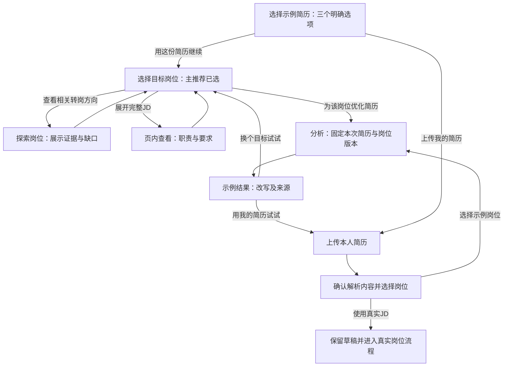

# Reffo Onboarding 预设选择体验优化方案

日期：2026-10-22。状态：供产品与设计评审的完整提案，尚未实施。

本方案以当前 Taro H5 的源码和已有体验报告为依据，重点覆盖“选择示例求职者 → 选择示例目标岗位 → 开始分析 → 看懂改写价值”。本轮仅新增本文档，没有修改前后端代码或预设配置，没有调用真实 AI 生成。文中的新增内容、交互、指标目标均为建议，不代表已经上线或经过用户验证。

## 1. 建议采用的主方案

将首次体验库从 **7 份简历、5 个 JD** 收敛为 **3 份示例简历、4 个示例 JD**，建立 **3 条主推荐关系、2 条转岗探索关系**。用户经过两张选择页面即可开始生成：

> 选一份示例简历 → 确认一个相关岗位 → 查看针对这个岗位的改写。

保留无需注册即可试用、纸张和卡片的品牌表现，以及真实分析链路。选择页面直接提供按钮；查看原简历、展开完整 JD、卡片动效均按需发生。

**首次体验要回答三个问题：这是谁的经历，准备投什么岗位，Reffo 为什么调整这些内容。** 人物数量、学校层次、薪资和静态分数均不应抢占这三个问题的位置。

| 决策 | 建议 |
| --- | --- |
| 示例求职者 | 应届前端、约 2 年数据分析、约 3 年内容运营 |
| 示例 JD | 初级前端工程师、业务数据分析师、用户运营专员、初级增长产品经理 |
| 首屏默认推荐岗位 | 每位求职者一个，按明确内容关系决定 |
| 转岗探索 | 数据分析、内容运营均可探索初级增长产品；注明证据和缺口 |
| 初始选择负担 | 求职者三选一；岗位默认一个，最多额外展示一个探索方向 |
| 全部岗位 | 在“查看其他示例岗位”中展开，总共四个 |
| 主要动作 | “用这份简历继续” → “为［岗位］优化简历” |
| 价值表达 | 有来源的重点调整、表达改写与待补充证据 |
| 身份说明 | “人物、公司和岗位均为虚构示例，仅用于体验” |

这是首次体验内容的取舍，不是已验证的目标用户分布判断。设计、医疗、科研和资深硬件产品等用户仍可使用自己的简历；这些示例可在以后有需求证据时进入专题体验库。

## 2. 当前体验的具体问题

| 当前事实 | 对首次体验的影响 | 本方案的处理 |
| --- | --- | --- |
| 有七份求职者简历与五个预设 JD | 浏览人物多，但区别和体验目的不够清晰 | 用三种职业阶段与经历类型组织内容 |
| 卡片的 `jobDescriptionId` 主要用于带出公司、岗位、地点 | 卡片关联没有形成下一页的推荐顺序和说明 | 建立可验证的关系表，实际控制默认选择和理由 |
| 岗位选择遍历同一组五个 JD，初始选择索引为 0 | 选不同人物也可能从同一岗位开始 | 按人物选主推荐，不按全局数组位置选岗位 |
| 存在应届视觉设计对 3–5 年 UX、医疗项目对通用运营等跨度 | 用户难以分辨这是转岗演示还是匹配失准 | 主推荐职级一致，转岗单列并说明缺口 |
| 简历多已具备成熟成果表达，JD 为摘要加三条职责 | 优化前后缺少清楚的比较基础 | 源简历有事实但重点分散，JD 明确职责与基本要求 |
| 牌组、人物详情、文件夹、岗位卡和只读表单组成多段操作 | 用户需要学习交互隐喻，才能开始核心体验 | 合并为两张选择页面，取消额外的只读确认页 |
| 出现“可投递的岗位”“最佳简历”及预设分数 | 容易被理解为真实招聘、已完成评估或结果保证 | 使用“示例目标岗位”“岗位定制简历”，不提前展示分数 |
| 前端和后端分别维护 JD；匹配优先使用后端预设 | 页面所见、实际分析与保存上下文可能漂移 | 同一版本、同一正文来源，并验证一致性 |

补充核对：虽然配置存在 `custom` 条目，但当前 onboarding 的岗位列表将其过滤，不能将它算作已经可用的自定义 JD 入口。本文将真实 JD 入口作为明确的流程建议，并保留现有鉴权边界。

## 3. 数量与内容取舍

| 现有示例 | 建议去向 | 理由 |
| --- | --- | --- |
| 小B：计算机硕士、前端实习和开源项目 | 重写为“应届前端” | 保留技术实习场景；去掉用高学历、开源影响力和夸张成绩建立认同的负担 |
| 小F：应用数学硕士、资深策略分析 | 重写为“约 2 年数据分析” | 用常见的 SQL、看板、漏斗分析展示业务表达优化 |
| 小E：多年内容负责人 | 重写为“约 3 年内容运营” | 保留内容、社群与用户反馈；用个人贡献展示运营经验的组织方式 |
| 小A：视觉设计应届 | 移出首次体验库 | 当前目标是 UX 且年限不一致；不为保留样例而硬设转岗 |
| 小C：临床医学、小D：生物统计 | 移出首次体验库 | 行业背景需要额外解释，首次体验较难快速理解 |
| 小G：资深硬件产品 | 移出首次体验库 | 长职业履历与当前互联网产品 JD 的职级、领域不一致 |

这里的“重写”指新建有版本的虚构示例，不能直接改写历史结果中的源简历快照，也不能把新人物当作旧人物事实的延续。

| 现有岗位 | 新方案 |
| --- | --- |
| 软件工程师，1–3 年 | 初级前端工程师，接受应届／0–1 年 |
| 数据分析师，2–4 年 | 业务数据分析师，1–3 年 |
| 用户运营经理，3–5 年 | 用户运营专员，1–3 年 |
| 互联网产品经理，3–5 年 | 初级增长产品经理，接受 1–3 年相关数据／运营背景 |
| UX 设计师，3–5 年 | 移出首次体验库 |

三个 JD 对应三条容易完成的主路径，第四个 JD 让数据和运营两类经历汇入同一目标，从而展示“一岗一简历”的区别。应届前端只有一个主推荐即可，不强行补第二个方向。

未采用“保留七个人物，仅补推荐标签”：选择负担和职级错位仍存在。未采用“三个人物只对应三个固定岗位”：能快速完成体验，但无法展示同一简历面向不同目标时如何调整。

## 4. 新的页面与动作链路

### 页面 A：选择一份示例简历

标题：**先选一份简历，看看怎么改**。

说明：**不用注册。选择一个示例，体验针对目标岗位调整简历。**

直接呈现三个紧凑的选择卡片。每张卡片只包含：职业阶段、短经历说明、两个事实标签、“查看原简历”、主按钮“用这份简历继续”。姓名是辅助信息，年龄、性别、性格判断不进入卡片。

**主按钮一次点击同时确定人物并进入岗位页。** 卡片容器不再承担“第一次选中、第二次进入”两种隐藏动作；原简历链接独立且不触发继续。没有额外的全局“下一步”确认。

建议固定顺序为应届前端、2 年数据分析、3 年内容运营。顺序用于浏览，不代表适配程度；不预选人物、不自动前进。三个卡片的权重一致，避免把示例推荐误认成对用户本人画像的判断。

始终可见的独立入口：**上传我的简历**。说明：**想看自己的效果？可以直接上传。** 它不藏在牌组末尾，也不做成第八张人物卡。

辅助入口：**稍后体验，进入首页**。用户跳过后仍能在首页找到新建入口。

### 页面 B：选择这份简历的目标岗位

标题：**这份简历，准备投什么岗位？**

顶部固定显示所选人物的职业阶段与经历摘要，提供“更换求职者”和“查看原简历”。主体展示该人物的一个主推荐；数据与运营人物额外显示一个较弱的“转岗探索”选项。应届前端不显示空的探索区。

首次进入且没有有效历史选择时，主推荐默认选中；再次进入恢复该人物已确认的岗位，旁边同时显示文字“已选”和对应的关系说明。用说明标注：**按示例经历预先配置，实际匹配结果将在分析后展示。** 不出现模拟 AI 计算、动态扫描或匹配百分比。

每个岗位卡片依次提供：岗位名称、经验要求、岗位目标一句话、三个能力关键词、关系理由、按需展开的“查看完整 JD”。公司和地点降为次要信息，薪资从首次示例里移除。全部岗位统一标注“虚构示例岗位”。

页面底部将两项选择并列呈现：**小周的示例简历 → 业务数据分析师**。主按钮：**为业务数据分析师优化简历**。辅助说明：**仅根据已有经历调整表达，缺少的经验会单独提示。**

“查看完整 JD”直接在本页展开，包含岗位职责、基本要求、加分项。展开不是生成的必经步骤，不再翻转进入看起来可编辑、实际只读的表单。

“查看其他示例岗位”展开其余岗位，并排除已经显示的重复项。与人物没有配置关系的岗位不显示推荐标签；用户选择后，页内提示：**这份经历与该岗位的直接证据较少，分析会指出差距。你也可以换回推荐岗位。** 允许继续，不把内容策划关系做成硬性的职业限制。

### 主路径的操作成本

从人物选择页开始，默认主推荐的最短路径为两次明确点击：**用这份简历继续 → 为已选岗位优化简历**。选择已显示的探索岗位增加一次操作；选择折叠区域内的岗位至少增加展开和选择两次操作。查看详情、滑动卡片、展开文件夹和反复点击同一卡片均不作为必经条件。

原有欢迎／价值说明页不在本轮重做；它们的体验入口应直接连接页面 A。本文不以“两次点击”描述从启动到完整结果的总成本。

### 本人简历与真实 JD 的分支

上传入口不要求先体验示例。上传取消回到原页面；失败保留当前选择并提供重试。解析成功后，展示文件名和内容预览，用户确认后再作为本次源简历使用。

本人简历没有策划过的固定岗位关系，所以不继承示例人物的默认岗位，也不直接展示“最适合你”。用户可以手动选择四个示例方向，页面明确说明这是体验用 JD。

使用真实 JD 时：已登录用户进入真实岗位输入；未登录用户在明确选择该动作后说明“使用真实岗位需要登录，已上传草稿会保留”，登录成功后回到该草稿。取消登录也应能返回原位置。当前访客权限依赖预设岗位 ID，不能只增加一个自定义输入框就宣称支持匿名真实 JD。

上传前说明应准确区分：**文件内容会发送到服务端用于解析和生成；访客草稿在本机保留，登录后同步需单独确认。** 这段文案需和最终实现的数据去向一致，不能仅写“保存在本地”让用户误以为无需联网处理。上传解析不应直接覆盖用户原有源简历；替换或保存应由用户明确触发。

## 5. 三位求职者的完整内容草案

以下人物、学校、公司、经历与数字均为本方案新设定的虚构示例。它们是后续生成应遵守的固定事实，不是实际用户资料，也不是本轮测试结果。相对年限以本版 2026-10 为准，后续发布要重新校验。

卡片的“可看的变化”和推荐理由用于引导，不混入源简历正文；分析输入只使用下列源简历事实。原简历要有内容、责任边界和少量数量证据，保留重点分散与表达普通的真实感。

### R1：小林｜应届前端

**卡片标题：** 应届前端｜实习＋校园项目

**卡片说明：** 做过 React 页面和表单联调，实习与项目重点有些分散。看看如何突出岗位需要的开发经历。

**事实标签：** 6 个月前端实习；React / TypeScript。

**源简历正文草案：**

> **小林**
>
> **基本信息**：计算机科学与技术本科，2026 年毕业，上海。求职方向：前端开发。
>
> **个人简介**：做过后台页面和校园活动网站，使用过 React、TypeScript，也写过一些 Node.js 接口。实习时主要跟着导师做功能、联调和问题修复，平时会记录遇到的问题。
>
> **教育经历**：示例大学，计算机科学与技术，本科，2022.09—2026.06。学习过数据结构、数据库、计算机网络和软件工程。
>
> **实习经历**：示例软件团队，前端开发实习生，2025.07—2025.12。参与订单管理后台，负责订单查询、编辑表单和权限配置三个页面的部分功能。按照设计稿使用 React、TypeScript 和 Ant Design 编写页面，与后端核对字段、错误提示和接口返回。跟随导师整理了表单校验与空状态组件，补充使用说明。根据测试反馈修复筛选状态丢失、重复提交和小屏布局问题，并参与发布前检查。关键方案由导师评审，自己主要负责功能实现。
>
> **项目经历**：校园活动报名网站，2026.01—2026.04，三人课程项目。负责活动列表、报名表单和个人报名记录；另用 Node.js 与 SQLite 实现报名和查询接口。给报名流程增加必填校验、失败提示和提交中状态。项目供两个社团试用，收集意见后调整了活动时间与地点的展示。使用 Git 协作，并为表单校验函数编写单元测试。
>
> **技能**：React、TypeScript、JavaScript、HTML、CSS；接触过 Node.js、SQLite、Git 和 Jest。能够完成常见页面开发与接口联调。

**预期可展示的变化：** 以页面实现与联调为主线组织经历；将重复的组件、错误处理和测试事实放到对应职责下；保留“导师评审、本人实现”的范围。

**不可生成的内容：** 性能提升百分比、独立架构设计、开源 star 数、超出课程项目事实的高并发与大规模用户。

### R2：小周｜约 2 年数据分析

**卡片标题：** 2 年数据分析｜看板＋漏斗分析

**卡片说明：** 做过指标看板和漏斗分析，简历更像工具与任务清单。看看如何讲清分析解决了什么问题。

**事实标签：** SQL 指标看板；注册到首单分析。

**源简历正文草案：**

> **小周**
>
> **基本信息**：统计学本科，2024 年毕业，杭州。求职方向：业务数据分析，也关注增长相关岗位。
>
> **个人简介**：目前主要给运营和产品同事提供数据，做过周报、用户漏斗和活动分析。日常使用 SQL、Excel，重复的数据整理会写 Python 脚本。参加过需求讨论和实验复盘，但没有独立负责过产品版本。
>
> **教育经历**：示例大学，统计学，本科，2020.09—2024.06。学习过概率统计、回归分析和数据库基础。
>
> **工作经历**：示例生活服务平台，数据分析师，2024.07—至今。维护注册、激活、首单等指标的 SQL 和周报，与运营、研发一起核对去重规则、时间范围和埋点差异。整理过三个来源的数据表，把常用指标口径放在共享文档中。用 Python 合并重复导出的文件；按连续四周的个人工作记录，周报整理耗时从每周约三小时减少到约一小时。每周向业务同事说明异常变化，并记录需要继续核查的问题。
>
> **项目经历**：新用户首单漏斗分析，2025.09—2025.12。根据产品同事提出的首单流失问题，拆分注册、填写地址、浏览服务和下单步骤，并按入口来源分组。排查了两处埋点口径问题，发现部分入口的地址填写环节退出较多。把发现、口径说明和建议整理成一页材料，参与产品评审，并在方案调整后跟踪数据。参与过该项目的 A/B 实验读数与结果复盘，产品方案和实验排期由产品经理负责，自己没有单独主导上线，也没有确认可归因于个人的转化提升。
>
> **技能**：SQL 联表与窗口函数、Excel、Python / Pandas、数据看板、漏斗与分群分析；了解 A/B 实验与基础统计检验。

**预期可展示的变化：** 业务分析方向突出问题、口径、方法、结论与跟进；增长产品方向突出问题定义、需求材料和验证协作，保留对独立产品交付经验的缺口提示。

**不可生成的内容：** 编造首单转化率提升、将参与实验写成主导增长、编造原型或完整 PRD、将脚本效率提升写成收入增长。

### R3：小陈｜约 3 年内容运营

**卡片标题：** 3 年内容运营｜社群＋活动复盘

**卡片说明：** 有内容、社群和活动经验，日常工作写得较散。看看如何突出用户触达、执行与复盘的联系。

**事实标签：** 3 个用户社群；内容与活动执行。

**源简历正文草案：**

> **小陈**
>
> **基本信息**：汉语言文学本科，2023 年毕业，广州。求职方向：用户运营、内容运营，也希望了解增长产品工作。
>
> **个人简介**：做过公众号内容、学习社群和线上活动，日常和讲师、设计、客服协作。会用 Excel 记录报名、到场和用户反馈。最近开始参与一些产品反馈整理，没有独立带团队或负责过产品版本。
>
> **教育经历**：示例大学，汉语言文学，本科，2019.09—2023.06。
>
> **工作经历**：示例学习社区，内容运营，2023.07—至今。维护三个用户社群，累计约 900 名用户；按照新加入、已参加活动和近期未互动等状态整理用户名单，发送不同的内容与提醒。负责公众号选题、稿件沟通和活动素材，与设计同事确认排期。遇到重复问题会更新欢迎说明和 FAQ，并把用户意见整理给客服、产品同事。日常工作以执行和跟进为主，整体运营目标由负责人制定。
>
> **项目经历一**：线上学习分享活动，2025.04—2025.08。参与四场活动，负责报名文案、社群提醒、讲师联络和活动后回访。其中一场有 90 人报名、62 人到场，数字来自报名表与会议签到记录。复盘时发现部分用户不清楚活动入口，调整了提醒模板，后续继续记录入口点击与到场情况，没有确认单项调整的独立效果。
>
> **项目经历二**：用户反馈整理，2026.02—2026.05。从社群和客服记录中整理 30 条课程使用反馈，按问题类型归类，补充复现步骤，与产品经理一起确认优先级。参与课程入口调整的上线检查和用户回访，产品方案由产品经理负责。
>
> **技能**：内容策划、社群维护、活动执行、用户访谈记录、Excel 与飞书；能整理基础活动数据与用户反馈。

**预期可展示的变化：** 用户运营方向把用户状态、触达、活动执行和复盘串联起来；增长产品方向突出用户问题、优先级讨论与发布验证协作。

**不可生成的内容：** 付费转化增长、留存提升百分比、预算规模、带团队经验、独立产品规划与不存在的原型能力。

## 6. 四份目标岗位 JD 完整草案

统一说明：**以下公司与岗位均为虚构示例，非真实招聘信息。** 地点只是示例背景，页面不提供投递入口，不展示未经来源支持的薪资。

JD 分为岗位目标、三条职责、三条基本要求、一条加分项。基本要求不为匹配源简历而全部放宽；能明确指出缺口，也是体验价值的一部分。

### J1：初级前端工程师

公司：示例协作软件公司。地点：上海。经验：接受应届毕业生／0–1 年相关经验。

**岗位目标**：参与协作产品的 Web 功能开发，将设计稿和业务规则实现为可用、易维护的页面。

**岗位职责**

1. 使用 React 与 TypeScript 开发列表、表单等功能，完成接口联调、状态反馈和基本响应式适配。
2. 参与组件复用与代码评审，为关键逻辑补充测试，处理测试与用户反馈中的缺陷。
3. 与产品、设计和后端协作确认交互与异常情况，记录实现方案并参与发布检查。

**基本要求**

1. 掌握 JavaScript、HTML、CSS 基础，理解 React 组件、状态和常见页面交互。
2. 有可说明个人贡献的实习或项目，能够讲清接口对接、错误处理和调试过程。
3. 能使用 Git 协作，并清楚记录问题、实现范围和待确认事项。

**加分项**：接触过自动化测试、可访问性或 Node.js 接口开发。

**卡片短文案**：实现页面、完成联调、处理异常。关键词：React / TypeScript / 接口联调。

### J2：业务数据分析师

公司：示例零售科技公司。地点：杭州。经验：1–3 年数据分析相关经验。

**岗位目标**：围绕新用户与交易流程，提供可信的指标、问题分析和可跟进的业务建议。

**岗位职责**

1. 维护核心指标、数据看板与口径文档，定位数据异常并与研发核对数据质量。
2. 根据业务问题开展漏斗、分群和活动分析，说明分析方法、结论与适用限制。
3. 与产品和运营讨论改进建议，参与实验评估，跟踪方案落地后的指标变化。

**基本要求**

1. 熟练使用 SQL 进行关联查询、聚合和窗口计算，能解释主要指标的统计口径。
2. 有从问题拆解、数据处理到结论汇报的完整案例，并能区分个人工作与团队结果。
3. 理解基础统计与 A/B 实验，能识别样本、埋点和归因限制。

**加分项**：能用 Python 自动化重复分析，或有与产品、运营协作推动建议的经历。

**卡片短文案**：从数据中定位问题，并跟进建议落地。关键词：SQL / 指标口径 / 漏斗分析。

### J3：用户运营专员

公司：示例知识服务公司。地点：广州。经验：约 1–3 年内容、社群或用户运营相关经验，重视实际案例与个人贡献。

**岗位目标**：围绕新用户参与和持续互动，执行清晰的内容、社群与活动运营方案。

**岗位职责**

1. 根据用户状态组织社群与内容触达，维护新用户引导、消息模板和常见问题说明。
2. 策划并执行线上活动，协调内容、设计与合作方，确保报名、提醒和回访流程完整。
3. 跟踪活动与用户反馈数据，整理复盘及改进建议，推动问题向产品或服务团队反馈。

**基本要求**

1. 有实际的内容、社群或活动案例，能够说明目标用户、执行过程与个人负责部分。
2. 能使用 Excel 等工具整理报名、参与和反馈数据，理解基本转化与留存指标。
3. 能编写清楚的用户文案，协调排期，并将复盘整理为可执行的后续事项。

**加分项**：有用户分层实践，或参与过用户反馈推动的产品改善。

**卡片短文案**：连接用户触达、活动执行与反馈复盘。关键词：用户分层 / 活动执行 / 数据复盘。

### J4：初级增长产品经理

公司：示例在线服务公司。地点：上海／杭州。经验：1–3 年相关经历，接受数据分析或运营背景转向产品。

**岗位目标**：在资深产品经理指导下，围绕新用户流程发现问题并推进小范围产品改进。

**岗位职责**

1. 结合用户反馈和行为数据梳理问题，明确目标用户、影响范围与需求优先级。
2. 将问题整理为需求说明和流程方案，与设计、研发确认范围、指标与验收条件。
3. 参与小步迭代、上线验收和效果复盘，记录实验结论与后续调整建议。

**基本要求**

1. 有使用用户反馈或数据发现问题的案例，能说明证据、假设和验证办法。
2. 能清晰描述流程与需求边界，有跨团队跟进事项、验证交付的实际经历。
3. 理解基础转化指标与实验思路，愿意承担需求文档、验收和持续复盘工作。

**加分项**：有独立完成的小功能需求、原型或上线案例。仅有分析和运营经历也可讨论，但应说明尚需补足的产品交付能力。

**卡片短文案**：把用户问题转化为可验证的小步迭代。关键词：需求梳理 / 指标定义 / 迭代验证。

J4 不作为“轻松转岗”的证明。两位相关示例都有问题发现和跨团队参与事实，但需求／流程方案与效果验证能力仍需进一步举证。独立完整交付尚无证据，属于加分项缺口，不能被抬高为本 JD 的硬性门槛。

## 7. 求职者与 JD 的关系规则

### 关系矩阵

| 求职者 | J1 初级前端 | J2 业务分析 | J3 用户运营 | J4 初级增长产品 |
| --- | --- | --- | --- | --- |
| R1 应届前端 | 主推荐、默认已选 | 其他示例 | 其他示例 | 其他示例 |
| R2 2 年数据分析 | 其他示例 | 主推荐、默认已选 | 其他示例 | 转岗探索 |
| R3 3 年内容运营 | 其他示例 | 其他示例 | 主推荐、默认已选 | 转岗探索 |

“主推荐”指便于理解的示例体验组合，不代表真实招聘判断。没有关联的七种组合仍可通过全部岗位入口访问，但不进入推荐区域。

### 五条关系的依据与边界

| 关系 | 页面显示的理由 | 对应事实 | 必须保留的缺口／限制 |
| --- | --- | --- | --- |
| R1 → J1 | 有 React 页面与接口联调经历，先看看如何突出前端开发能力 | 三个后台页面的部分功能、表单组件协作、校园网站与测试 | 初级职级；不扩大架构、性能与项目规模 |
| R2 → J2 | 有 SQL 指标与漏斗分析经历，看看如何讲清业务分析贡献 | 指标口径、周报脚本、首单漏斗、实验读数 | 参与分析不等于独立带来业务增长 |
| R3 → J3 | 有社群、活动与反馈经验，看看如何组织成用户运营经历 | 用户状态分组、四场活动、FAQ、反馈整理 | 留存、付费转化等没有证据；不要把执行写成团队管理 |
| R2 → J4 | 想转向产品？看看分析经历能支持哪些需求与验证工作 | 问题材料、评审、指标与实验协作 | 需补充需求／流程方案的证据；独立端到端交付属于加分项缺口 |
| R3 → J4 | 想转向产品？看看用户反馈和上线协作如何表达 | 反馈分类、复现步骤、优先级讨论、上线检查 | 需补充需求／流程方案、指标定义与实验评估理解的证据；独立交付属于加分项缺口，不能把活动复盘写成 A/B 实验 |

探索项统一显示“转岗探索”标签和“查看已有证据与差距”的短说明，展开后展示各自具体缺口，不使用与主推荐相同的视觉权重。生成前不输出适合程度分数，也不把加分项缺失当作基本要求不达标。

### 为什么同一份简历要有不同目标

以 R2 为例，选择 J2 时主要组织“问题—口径—方法—结论—跟进”；选择 J4 时主要组织“问题证据—需求材料—评审协作—验证参与”，并指出产品交付缺口。两种版本的事实、数字和责任边界相同。

以 J4 为例，R2 的依据偏数据与实验，R3 的依据偏用户反馈与上线协作。不能因为目标相同，就给两人生成相同的产品经理经历。

## 8. 状态、返回与失败处理

| 场景 | 必须遵守的行为 |
| --- | --- |
| 第一次选人物 | 进入岗位页，明确预选该人物的主推荐；不自动开始分析 |
| 返回人物页但未换人 | 保留本人物刚选的岗位和展开内容；浏览不改变选择 |
| 实际选择另一个人物 | 恢复新人物本次会话内的选择；新人物未选过则使用其主推荐。提示“已切换为小陈的示例与对应岗位” |
| 新人物岗位关系不同 | 不静默沿用上一人物的岗位。人物与岗位作为一组更新；用户可手动选择其他岗位 |
| 同一人物换岗位 | 保留原简历，只切换目标与关系说明；旧结果仍属于旧组合 |
| 返回已有结果的原组合 | 提供“查看上次结果”和“重新生成”；不因返回自动再次发起生成 |
| 配置缺失或版本不一致 | 不回落到数组第一项。说明“这个示例暂时不可用，请换一组体验”，允许选择其他人物 |
| 上传取消／解析失败 | 保留已有示例与岗位，停留原位置；提供重试，不留下空简历状态 |
| 从示例切为本人简历 | 清除示例人物的推荐状态；保留本人草稿，重新确认目标 |
| 开始分析 | 固定简历、JD、版本与请求标识；防止重复提交。请求隔离覆盖分析、匹配、优化简历、面试建议与保存操作，旧组合不得覆盖新组合 |
| 分析中想更换组合 | 提示“返回修改将结束当前等待”；先使当前请求失效，再恢复选择页。不能假装服务端计算已经取消，除非有真实取消能力 |
| 接口失败 | 显示失败环节与“重试”“返回修改”；保留已完成的阶段，只重试失败或未完成阶段。重试仍用原组合，限制或登录要求使用准确文案，不归为泛化网络错误 |
| 刷新／重开 | 本机恢复选择草稿并显示“继续上次体验”；有结果则恢复结果。未确定任务状态时先查询或提示重新操作，不自动重复生成 |
| 离开示例 | 示例草稿、示例结果与本人简历分开；不覆盖已有个人源简历或将虚构示例设为默认个人资料 |
| 登录与同步 | 示例记录应明确标记。本人草稿同步需用户主动同意；“暂不同步”保留本机副本，删除为独立明确动作 |

选择草稿的建议保留期为 7 天，提供清除入口；该期限是待实施的产品规则，并非当前承诺。生成结果的保存沿用单独的结果管理策略，在结果页说明，不因选择草稿到期而静默删除已保存结果。

## 9. 视觉、文案和可访问性

### 布局与品牌表达

移动端使用三个纵向紧凑卡片；桌面可并列三个选项。岗位页使用“所选简历摘要 + 目标岗位”的并置关系：移动端上下排列，宽屏左右排列，生成按钮始终靠近组合摘要。

保留 Reffo 当前蓝色、浅蓝背景和纸张材质。建议用于本流程的紧凑配色为：行动蓝 `#0B70F5`、正文墨色 `#111111`、纸张白 `#FFFFFF`、背景浅蓝 `#EEF4FB`、分隔灰 `#D9E2EC`、探索提示棕 `#8A4B08`。正文与提示的最终对比度须在实现后测量；状态同时用文字和图形表达，不只靠颜色。

标题使用现有系统中文黑体的较强字重，正文沿用现有系统字体；数字和技术关键词采用系统等宽字体作为辅助。建议层级为页面标题 24–28、卡片标题 18–20、正文 14–16、辅助说明 12–13，具体单位与缩放继续遵循 Taro H5 规则，不新增字体下载依赖。

**本流程唯一的标志性动效：选中的简历纸张靠近目标岗位纸张，形成清楚的一组材料。** 用它解释“同一份经历与不同目标形成不同版本”。取消必须滑动才能揭示下一步的依赖；文件夹可作为装饰或局部反馈，不再单独占一个确认步骤。

既有首页 210×332 的卡片比例与首页材质规则不随本方案改变；选择页可以使用独立的紧凑卡片布局，避免把完整首页卡片硬塞进三项选择列表。

### 页面文案清单

| 位置 | 建议文案 |
| --- | --- |
| 人物页标题 | 先选一份简历，看看怎么改 |
| 人物页说明 | 不用注册。选择一个示例，体验针对目标岗位调整简历。 |
| 示例身份 | 人物、公司和岗位均为虚构示例，仅用于体验。 |
| 人物主操作 | 用这份简历继续 |
| 原文入口 | 查看原简历 |
| 本人入口 | 上传我的简历 |
| 岗位页标题 | 这份简历，准备投什么岗位？ |
| 主推荐关系 | 推荐体验 · 已选 |
| 推荐性质说明 | 按示例经历预先配置，实际匹配结果将在分析后展示。 |
| 次选关系 | 转岗探索 · 查看已有证据与差距 |
| 全部岗位 | 查看其他示例岗位 |
| 正文入口 | 查看完整 JD |
| 岗位主操作 | 为［岗位名称］优化简历 |
| 生成辅助说明 | 仅根据已有经历调整表达，缺少的经验会单独提示。 |
| 等待状态 | 正在分析经历／正在对照岗位／正在整理简历表达 |
| 等待较长 | 还在处理中，你可以继续等待或返回修改。返回将结束当前等待。 |
| 结果标记 | 示例结果 · 小周 → 业务数据分析师 |
| 结果主操作 | 用我的简历试试 |
| 结果次操作 | 换个目标试试 |

长岗位名称允许按钮文本换行或使用“优化这份简历”，同时在组合摘要中完整呈现岗位；不得通过字体缩到难读来塞入固定宽度。

### 可访问性与响应式验收口径

关键路径均可点按和键盘完成。人物继续按钮、原文链接与岗位单选控件语义独立，避免嵌套按钮。岗位选中状态、推荐性质、展开状态可被读屏读取；进入下一页焦点落在标题，关闭预览后回到触发按钮。

H5 点击区域建议至少 44×44 CSS 像素；RN 使用平台等效逻辑尺寸，最终按设备验证。支持系统放大、文本换行和安全区；底部固定动作不覆盖最后一条内容。低性能等级与减少动态效果模式下直接切换状态，仍完整显示人物与岗位关系。

## 10. 结果页如何证明优化有价值

先显示本次人物和岗位。分析／匹配完成时可以先展示证据与缺口；只有优化简历实际生成成功，才展示 2–3 条可追溯的改写变化。每条包含“原文片段、调整后的表达、为什么与这个 JD 相关、源事实位置”。没有足够改写价值时直接说明，不固定生成“提升显著”。面试建议是独立后续阶段，不能阻止用户阅读已完成的优化简历；某个阶段失败时保留其余内容并提供局部重试。

建议的变化类型：

- **重点调整**：把与岗位直接相关的经历放到前面，说明调整了哪些内容。
- **表达调整**：将分散任务组织为问题、动作、交付与协作，保留参与范围。
- **证据缺口**：明确什么尚未发生、什么尚无数据，给出可补充材料的方向。

以下为说明呈现方式的编辑示意，不是实测模型输出，也不是必须一字不差出现的结果：

> **R2 → 业务数据分析师**
>
> 原文：“拆分注册、填写地址、浏览服务和下单步骤，并按入口来源分组。”
>
> 可整理为：“围绕新用户首单流失问题，构建注册至下单漏斗并按入口来源分组，排查两处埋点口径问题，定位地址填写环节的流失线索；将分析与建议提交产品评审，参与调整后的数据跟踪。”
>
> 对应 JD：漏斗分析、数据质量与建议跟进。保留限制：不补写转化提升，不声称独立负责产品方案。

> **同一 R2 → 初级增长产品经理**
>
> 可强调：“依据首单漏斗分析整理用户问题、指标口径和改进建议，参与需求评审与实验复盘，协助产品团队跟踪方案效果。”
>
> 仍应指出：需要进一步补充需求／流程方案的证据；独立完整产品交付尚无证据，但在这份 JD 中属于加分项。不能把上述内容改成“独立设计并上线新用户增长策略”。

“换个目标试试”返回岗位页，保留同一份简历。已有结果保留为各自组合的版本；只有两个组合的优化简历均实际生成成功，才能展示两版的改写差异，不能把仅有的匹配分析当作优化版本，也不能预填固定的优化幅度。

## 11. 后续实现约束与交付范围

本节用于让方案可落地，不要求本轮开发。

### 内容与关系契约

内容应有一个权威来源，可由共享文件生成前后端所需数据，或由服务端按版本提供；不再人工复制两套 JD 正文。简历、JD、关系和结果分别保留版本，展示摘要不能替代分析正文。

| 对象 | 后续至少应表达的内容 |
| --- | --- |
| 示例简历 | 稳定 ID、内容版本、显示名称、职业阶段、卡片说明、原始 Markdown、虚构标识、事实索引 |
| 示例 JD | 稳定 ID、版本、岗位名称、经验要求、岗位目标、职责、基本要求、加分项、虚构标识、正文摘要校验 |
| 人物—岗位关系 | 人物 ID、岗位 ID、主推荐／探索类型、顺序、理由、源事实引用、缺口、表达重点 |
| 当前选择 | 人物与岗位 ID／版本、是否用户主动选择、页内草稿与该人物的上次岗位 |
| 分析记录 | 简历与 JD 的不可变快照、组合标识、请求标识、版本、来源类型、结果进度 |

建议使用新内容 ID／新版本发布，兼容历史预设 ID 的已保存记录；旧组合展示其旧快照，不因新版下架而变成空白。后端访客白名单、前端类型与关系引用要在同一发布中更新。遇到版本不一致，明确提示更新示例，不静默用另一份正文分析。

候选排序只依赖显式的关系配置；AI 的分析结论在生成后独立呈现。两者不相互冒充。

### 分期建议

| 阶段 | 范围 | 完成标准 |
| --- | --- | --- |
| 首批上线必须一起交付 | 3 份简历、4 个完整 JD、5 条关联、两页点按路径、默认主推荐、详情展开、返回保留、内容版本一致、示例身份、结果不覆盖本人资料、关键无障碍 | 三条默认路径与两条探索路径可以稳定完成，无错用简历／岗位 |
| 同批配套验证 | 失败重试、旧请求隔离、刷新恢复、上传分支、鉴权回流、历史兼容与埋点 | 不丢草稿、不重复生成、不以空白状态兜底 |
| 后续增强 | 两个真实生成版本的并排比较、专题示例库、基于实测数据的顺序调整 | 先观察核心任务，再决定是否扩大内容库 |

本轮不扩展真实职位发现或投递能力；“示例目标岗位”不承担真实职位推荐的角色。匿名真实 JD 如果未来要开放，需要单独设计权限、额度与失败回流，不包含在这次示例选择优化的默认范围中。

## 12. 验证计划、事件与成功标准

### 内容校验

发布前检查三个简历、四个 JD、五条关系的引用完整；每个人物恰有一个主推荐，每个 JD 至少有一条关系，探索项均有理由与缺口；移除职位、学历、年龄和工作年限之间的矛盾。

对前后端实际使用的 JD 做逐字段／正文一致性校验，尤其是基本要求、经验与加分项。检查所有示例文案没有真实招聘承诺、静态匹配分或生成前的结果保证。

### 功能与生成质量

| 验证组 | 覆盖内容 |
| --- | --- |
| 三条主路径 | R1→J1、R2→J2、R3→J3；确认前端展示、请求和结果上下文使用同一组合 |
| 两条探索路径 | R2→J4、R3→J4；确认相关事实不同，产品交付缺口保留 |
| 非推荐选择 | 例如 R1→J2；清楚提示直接证据少，用户仍可主动继续 |
| 连续操作 | 换人、换岗位、返回、查看原文、展开 JD、重试；无旧岗位与新简历串用 |
| 请求与恢复 | 重复点击、慢网、超时、刷新、旧回包、配置失效、结果恢复 |
| 本人分支 | 上传取消／失败／成功、真实 JD 登录回流、取消登录、草稿保留、未覆盖个人资料 |
| 多端表现 | 393px 手机视口、窄屏 320px、平板和桌面；H5 键盘、读屏、减少动态效果；影响 RN 时补真机验证 |

生成质量至少覆盖五条关联组合，每个组合先做两次真实生成，作为上线前的初始审查，观察波动而不是据此证明长期稳定。逐条核对人物、数字、职责、工具和项目来源；所有新增事实、错误归因和虚构成果必须修正。探索关系必须允许模型判断证据不足，不能为了演示成功而强制高匹配。

### 小规模可用性验证

建议邀请 6–8 位首次使用者，覆盖应届、数据／运营经验和不属于三个示例职业的用户；这是定性验证，不作为转化统计显著性的依据。采用相同任务比较现有流程和方案原型，顺序交叉安排，避免所有人先做旧版导致学习偏差。

任务包括：不听解释完成一次示例生成；说清所选人物、目标与推荐理由；更换人物后确认目标；用同一人物探索增长产品并指出缺口；从示例转向本人简历。记录停顿位置、误触、求助、完成时间和理解错误。

### 指标口径

| 事件／指标 | 口径与用途 |
| --- | --- |
| 选择页曝光 | 每个体验会话首次进入人物选择页，作为选择漏斗的起点 |
| 人物确定 | 点击“用这份简历继续”，记录示例 ID／版本 |
| 岗位确定 | 记录选中岗位、关系类型与默认／手动选择；与生成开始区分 |
| 查看原文／JD | 理解信息需求；不把详情打开率越高当作越成功 |
| 体验路径 | 分开记录示例路径与本人路径。点击“用这份简历继续”计为明确进入示例路径；点击上传计为本人路径进入，成功解析单独记录 |
| 分析开始／分阶段结果可见 | 分开记录匹配结果、优化简历和面试建议的可见状态，不用页面跳转代替内容成功 |
| 总体进入体验率 | 从示例或本人路径发起分析的去重会话数 ÷ 人物选择页曝光会话数；两条路径取并集，避免将本人路径算作示例流失 |
| 示例路径继续率 | 从示例路径发起分析的去重会话数 ÷ 点击过“用这份简历继续”的去重会话数；衡量人物确定后的岗位确认环节 |
| 本人路径继续率 | 从本人路径发起分析的去重会话数 ÷ 点击上传的去重会话数；解析成功至分析开始另报阶段转化 |
| 分析结果到达率 | 分析／匹配结果可见的去重会话数 ÷ 发起分析会话数，按两条来源分别统计 |
| 优化简历到达率 | 优化简历实际生成且可见的去重会话数 ÷ 发起分析会话数；作为核心价值到达指标，按来源分别统计 |
| 选择耗时 | 示例人物选择耗时为页面曝光至确定人物；示例岗位确认耗时为确定人物至分析开始。本人路径另计上传、解析和目标确认耗时，与服务端生成耗时分开 |
| 本人简历尝试 | 结果后进入上传、成功解析、开始本人生成分别记录，不用点击量代替真正使用 |
| 退出与错误 | 区分主动跳过、接口失败、权限要求、上传失败和主动返回修改 |

事件只记录示例 ID、版本、关系与流程状态，不上传简历正文、文件名或用户输入作为分析属性。发布前固定会话去重、重复尝试与异常排除口径。

**待验证的初始目标**：无讲解情况下，至少 80% 的测试参与者完成选择并开始分析；至少 80% 能准确说清所用人物与目标；三条默认路径点按可达率 100%；状态组合、快照与前后端 JD 一致性检查通过率 100%。这些是评审目标，不是已达成结果。

线上先建立现状基线，再观察总体进入体验率、示例路径继续率、选择耗时、优化简历到达率与本人简历实际尝试；不预先宣称提升某个百分比。同一会话尝试过两条路径时，总体指标按会话去重，分路径指标按对应路径计算，不将两项直接相加。模型服务延迟、接口失败率与成本作为单独的观察项，避免把内容方案的收益与服务性能变化混在一起。

## 13. 评审时需要确认的决策

以下均已给出推荐默认值，不需要在开始读方案前逐项回答：

1. 首次体验是否采用 3 人物＋4 JD；建议采用，行业专题后置。
2. 是否保留增长产品探索；建议保留，但降低权重并显示交付缺口。
3. 是否去掉示例薪资、年龄、性别和预设评分；建议全部移除。
4. 是否合并岗位列表与只读详情确认；建议合并，默认组合可直接开始。
5. 是否允许选择不相关的示例岗位；建议允许，显式说明证据有限。
6. 是否将本人真实 JD 放在登录后的完整流程；本次建议沿用该边界，保留草稿回流。
7. 是否隔离示例记录与本人资料；建议作为上线前置条件，示例不自动替换个人源简历。

## 14. 当前事实的源码依据

以下行号为 2026-10-22 核对时的位置，后续实现可能变动。

- [前端预设数据：岗位、完整简历与人物卡](/Users/haishuanglong/Desktop/reffo/reffo/frontend/Taro/reffo-taro/src/pages/landing/config/presets.json)
- [人物卡关联岗位的当前用途](/Users/haishuanglong/Desktop/reffo/reffo/frontend/Taro/reffo-taro/src/pages/landing/index.tsx:153)
- [岗位初始选择](/Users/haishuanglong/Desktop/reffo/reffo/frontend/Taro/reffo-taro/src/pages/landing/index.tsx:662)
- [人物详情、文件夹与岗位展开](/Users/haishuanglong/Desktop/reffo/reffo/frontend/Taro/reffo-taro/src/pages/landing/index.tsx:864)
- [岗位草稿正文组装](/Users/haishuanglong/Desktop/reffo/reffo/frontend/Taro/reffo-taro/src/pages/landing/index.tsx:953)
- [全部预设岗位与只读表单](/Users/haishuanglong/Desktop/reffo/reffo/frontend/Taro/reffo-taro/src/pages/landing/index.tsx:2236)
- [当前 custom 过滤规则](/Users/haishuanglong/Desktop/reffo/reffo/frontend/Taro/reffo-taro/src/pages/landing/constants/job-descriptions.ts:17)
- [简历／岗位选择状态](/Users/haishuanglong/Desktop/reffo/reffo/frontend/Taro/reffo-taro/src/store/landingFlowStore.ts)
- [Landing 实际使用的源简历](/Users/haishuanglong/Desktop/reffo/reffo/frontend/Taro/reffo-taro/src/pages/create/usePageModel.ts:1116)
- [预设 ID 匹配与结果上下文](/Users/haishuanglong/Desktop/reffo/reffo/frontend/Taro/reffo-taro/src/pages/create/usePageModel.ts:1213)
- [后端预设内容](/Users/haishuanglong/Desktop/reffo/reffo/backend/src/config/landing-presets.json)
- [后端 JD 正文构造](/Users/haishuanglong/Desktop/reffo/reffo/backend/src/config/landing-presets.ts:14)
- [访客预设岗位权限条件](/Users/haishuanglong/Desktop/reffo/reffo/backend/src/routes/mvp.ts:115)
- [后端匹配优先采用预设](/Users/haishuanglong/Desktop/reffo/reffo/backend/src/routes/mvp.ts:450)
- [上一轮 Onboarding 体验报告与实测边界](/Users/haishuanglong/Desktop/reffo/reffo/docs/testing/reffo-onboarding-experience-report-2026-10-22.md)

本方案完成的是内容、交互与实施约束的设计评审准备。尚未进行新方案的浏览器交互验证、真人测试或真实模型生成，不能将本文的示意和目标写成实测结论。
