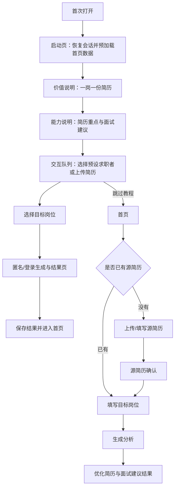

# Reffo 新用户 Onboarding 体验报告

- 评估日期：2026-10-22
- 评估对象：Taro 前端 H5，从首次打开到完成首次简历生成的链路
- 评估方式：代码链路梳理、现有组件/流程自动化测试、H5 构建；本报告属于专家启发式评估，不代表真人可用性研究或线上转化数据。

## 结论

链路设计方向正确：用户可以先体验核心价值，不必先注册；既可以使用预设求职者，也可以上传自己的简历；访客生成结果会保存在本地，登录后按云端数据情况询问是否同步。当前“不同步”会清除本地待同步简历和结果，但弹窗没有说明这一后果，存在资料意外丢失风险。其他主要问题集中在体验入口和输入方式：引导队列把多段触摸手势放在核心路径上，关键控件没有完整的键盘和读屏语义；首次启动还要等首页数据预加载完成才进入引导。整体可用，但第一次完成体验的成本偏高，建议优先明确本地数据去向、降低手势依赖并补齐无障碍交互。

## 流程地图

首次启动时，首页路由会被引导到 Landing；完成引导或跳过后写入 `reffo.landing.seen`，后续启动直接进入首页。用户也可以在 Landing 里用预设简历或上传自己的简历，选预设岗位后进入内嵌生成和结果页。匿名结果会进入本地待同步数据，用户登录后首页启动流程会尝试同步。

代码依据：[app.ts](../../frontend/Taro/reffo-taro/src/app.ts#L13)、[landing/index.tsx](../../frontend/Taro/reffo-taro/src/pages/landing/index.tsx#L535)、[landing-analysis/index.tsx](../../frontend/Taro/reffo-taro/src/pages/landing-analysis/index.tsx#L65)、[create/types.ts](../../frontend/Taro/reffo-taro/src/pages/create/types.ts#L1)、[pending-landing-data.ts](../../frontend/Taro/reffo-taro/src/utils/pending-landing-data.ts#L34)。

## 体验判断

| 环节 | 判断 | 依据 |
| --- | --- | --- |
| 价值表达 | 清晰 | 首屏先说明“一岗一份简历”，下一步解释会重组简历重点并准备面试建议。 |
| 体验门槛 | 中等偏高 | 前两步可点按继续，交互队列包含横向拖动、下滑展开、进入文件夹、选择岗位等动作。 |
| 核心价值验证 | 较好 | 用户可以直接体验预设简历或上传本人简历，并进入真实生成链路。 |
| 注册策略 | 较好但需明确数据去向 | Landing 支持访客使用；登录后可能询问同步，但选择“不同步”会清理本地待同步数据。 |
| 可访问性 | 待改进 | 多个关键入口使用绑定 `onClick` 的 `View`，未提供完整的按钮角色、键盘操作和焦点支持。 |
| 启动韧性 | 有风险 | 引导展示依赖会话恢复和首页数据预加载完成；启动画面只有动画点，没有可操作的重试或跳过入口。 |

## 优先改进项

### P1：明确“不同步”会删除本地材料

登录后同步 Landing 数据时，弹窗只问是否同步，按钮为“同步”和“不同步”；无论用户拒绝同步还是同类数据已存在于云端，待同步简历/生成记录都会从本地存储清除。用户可能把“不同步”理解为“暂不上传、继续留在本机”，实际结果却是本地资料被删除。简历和生成结果难以重建，这会伤害信任并造成真实数据损失。

建议把本地数据去向作为明确选择：展示“同步到账号”“仅保留在本机”“删除本机数据并继续”等清晰选项；若产品决定拒绝同步即删除，应在确认文案里说明会删除哪些材料、是否可恢复，并让删除成为独立的明确动作。

证据：[pending-landing-data.ts](../../frontend/Taro/reffo-taro/src/utils/pending-landing-data.ts#L86)、[pending-landing-data.ts](../../frontend/Taro/reffo-taro/src/utils/pending-landing-data.ts#L101)、[pending-landing-data.ts](../../frontend/Taro/reffo-taro/src/utils/pending-landing-data.ts#L119)。

### P1：降低队列的手势学习成本

引导前两步有“右滑继续”和可点击入口；进入队列后，选择求职者、查看详情、进入岗位文件夹等操作主要依靠横向或纵向手势。用户必须先理解牌组和文件夹的隐喻，再完成多个连续动作；手势失败时虽然可以跳过，但会失去内嵌体验。

建议在队列首屏提供两个明确且始终可见的动作：“上传我的简历”和“试用示例简历”，随后用一个可点选的岗位列表继续。牌组动画可以保留为视觉反馈，但不要让动画手势成为理解或继续的前置条件。

证据：[landing/index.tsx](../../frontend/Taro/reffo-taro/src/pages/landing/index.tsx#L1766)、[landing/index.tsx](../../frontend/Taro/reffo-taro/src/pages/landing/index.tsx#L2164)、[landing/index.tsx](../../frontend/Taro/reffo-taro/src/pages/landing/index.tsx#L2213)。

### P1：让继续、跳过和卡片选择可被键盘与读屏使用

继续和跳过入口是带 `onClick` 的 `View`，没有按钮角色、`tabIndex` 或键盘事件；岗位卡片也以点击处理选择。简历上传和文件夹部分状态添加了 `role="button"`，但仍需焦点与 Enter/Space 行为才能形成完整键盘交互。当前实现对只用键盘或屏幕阅读器的用户不够可达。

建议将这些动作实现为真实按钮或统一的可访问按钮组件，补上可见焦点、准确的可访问名称、禁用态和键盘触发；教程页码应提供当前步骤和总步骤，而不只呈现视觉圆点。

证据：[landing/index.tsx](../../frontend/Taro/reffo-taro/src/pages/landing/index.tsx#L2336)、[landing/index.tsx](../../frontend/Taro/reffo-taro/src/pages/landing/index.tsx#L2465)、[landing/index.tsx](../../frontend/Taro/reffo-taro/src/pages/landing/index.tsx#L2476)。

### P2：把启动等待与首页预加载解耦

Landing 在显示引导前等待 `restoreSession()` 和首页数据预加载。加载阶段只显示品牌和动画点，没有耗时说明、重试或进入体验的兜底。网络慢或会话恢复延迟时，新用户会把等待理解成页面卡住。

建议启动动画维持短暂品牌过渡后就显示 onboarding；首页数据在后台继续准备，在进入首页时展示局部加载状态。若会话恢复确实影响访客分流，应设置明确超时并允许继续访客体验。

证据：[landing/index.tsx](../../frontend/Taro/reffo-taro/src/pages/landing/index.tsx#L535)、[landing/index.tsx](../../frontend/Taro/reffo-taro/src/pages/landing/index.tsx#L1370)、[landing/index.tsx](../../frontend/Taro/reffo-taro/src/pages/landing/index.tsx#L2520)。

### P2：在简历上传前说明材料如何保存

简历属于高敏感个人资料。当前 Landing 上传路径会根据登录状态将简历保存到账号服务端或本地待同步区，但引导上传文案只解释“上传后更契合目标职位”，没有说明保存位置、登录后同步方式和用户如何删除。

建议在上传动作附近用短文案说明：访客材料保存在当前设备；登录后同步前会征求同意；用户可在源简历管理处删除。文案应与实际保留和清理策略一致。

证据：[landing/index.tsx](../../frontend/Taro/reffo-taro/src/pages/landing/index.tsx#L1157)、[landing/index.tsx](../../frontend/Taro/reffo-taro/src/pages/landing/index.tsx#L2444)、[pending-landing-data.ts](../../frontend/Taro/reffo-taro/src/utils/pending-landing-data.ts#L52)。

### P2：补一条访客数据贯穿的回归测试

当前测试覆盖引导状态、队列交互、创建流程、认证表单和结果状态，但未找到覆盖“访客上传简历 → 完成生成 → 保存本地结果 → 登录后同意/拒绝同步”的端到端测试。特别是“不同步”是否清理材料、云端已有简历时如何处理本地副本，都缺少回归验证；代码里存在用户可见的数据删除行为，但没有明确的界面告知。

建议新增隔离存储的流程测试，至少核对：访客生成不会写入认证历史接口；源简历和结果都能从本地恢复；登录后仅在用户同意时上传；拒绝同步、选择仅保留本机、云端已有数据三种情况分别符合产品承诺。

证据：[result/usePageModel.ts](../../frontend/Taro/reffo-taro/src/pages/result/usePageModel.ts#L610)、[pending-landing-data.ts](../../frontend/Taro/reffo-taro/src/utils/pending-landing-data.ts#L50)、[home-data-bootstrap.ts](../../frontend/Taro/reffo-taro/src/utils/home-data-bootstrap.ts#L10)。

## 验证结果与边界

- 通过：6 个 Jest 套件，共 95 项测试，覆盖 Landing 启动和跳过、队列交互、创建页、首页入口、认证表单、结果状态和存储工具。
- 通过：`corepack pnpm@10.33.2 build:h5`，Webpack 编译成功。Browserslist 过期、资源体积超限和 `webpackExports` 为构建警告，不影响本次构建成功结论。
- 通过：本地静态预览入口 `http://127.0.0.1:4173/` 返回 `HTTP 200`；此项只验证 HTML 入口可访问，不等同于浏览器渲染验收。
- 未覆盖：真实浏览器中的视觉、键盘和屏幕阅读器操作；当前环境没有 Playwright/Puppeteer，也没有可用的 `adb`，因此没有做 Android 真机验证。
- 未覆盖：真实文件选择器、生产 AI 生成时延、真实账号登录及同步确认。现有自动化使用模拟数据和组件环境；本次没有调用真实生成服务。

建议下一轮先交付队列的显式按钮路径和完整无障碍语义，再用一名首次使用者在手机 H5 上执行“访客试用”和“上传本人简历”两条任务，记录任务完成率、完成时间、手势误操作和跳过率。
